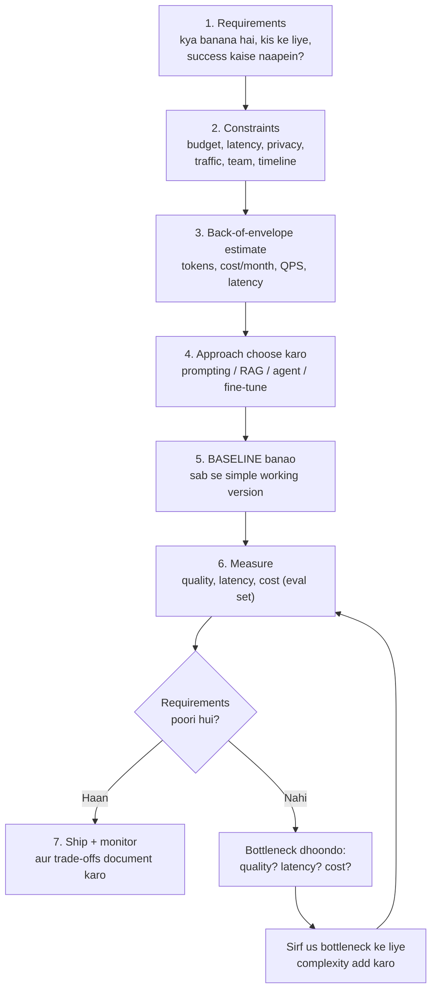
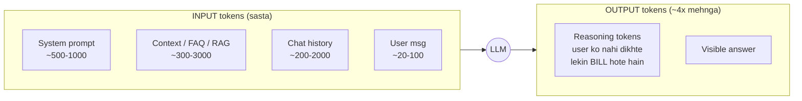
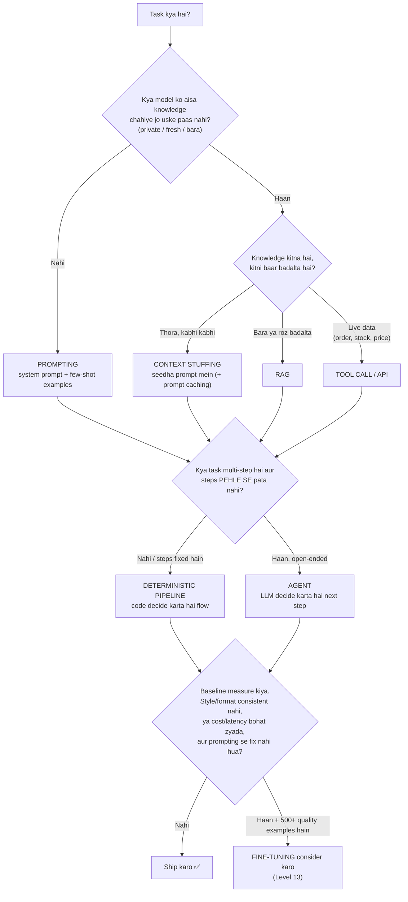
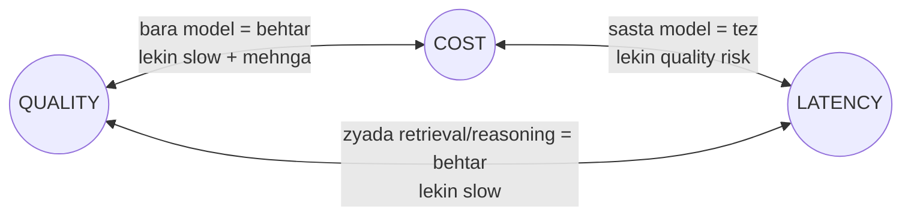

# M9.1 · The AI System Design Framework

> **Outcome:** Product requirement ko ek **defensible AI architecture** mein convert karna,
> bajaye is ke ke apni favourite technology (RAG, agents, LangGraph) se shuru kar dein.

**Is module ke baad aap ye kar sakenge:**
- Kisi bhi AI project ke liye sahi sawal poochna (requirements + constraints)
- 2 minute mein cost, traffic aur latency ka rough hisaab lagana
- Decide karna: prompting, RAG, agent, ya fine-tuning?
- Quality ↔ latency ↔ cost trade-off ko numbers ke saath explain karna
- Pehle baseline banana, aur complexity tabhi add karna jab data kahe

---

## 1. System design hota kya hai? (Simple samjhao)

Socho aap ghar bana rahe ho. Mistri seedha eentein lagana shuru nahi karta. Pehle **naqsha** banta hai:
- Kitne log rahenge? (traffic)
- Budget kitna hai? (cost)
- Kitne din mein chahiye? (latency / timeline)
- Zameen kaisi hai, kya rules hain? (constraints)

Phir faisla hota hai: 1 manzil ya 3, lantar ya steel structure.

**AI system design bhi yahi hai.** Level 0–8 mein aap ne eentein banana seekha (RAG, agents, evals, security).
Ab ye seekhna hai ke **kaun si eent kahan lagani hai, aur kyun**, aur us "kyun" ko
interviewer ya client ke saamne **defend** karna hai.

> 🔑 **Golden rule:** System design mein "sahi jawab" nahi hota. **Defend kiya hua jawab** hota hai.
> "Maine X choose kiya kyunke requirement Y thi, aur Z isliye reject kiya kyunke uski cost/latency/complexity ye thi."

---

## 2. The framework: 7 steps

Har AI system (interview ho ya client project) in steps se guzarta hai:



Note karein: **step 5 (baseline) step 4 ke foran baad hai**, aur loop sirf tab chalta hai jab measurement kahe.
Yahi farq hai junior aur senior engineer mein.

---

## 3. Step 1–2: Requirements & constraints

### 3.1 Teen tarah ki requirements

| Type | Sawal | Example (WhatsApp support bot) |
|---|---|---|
| **Functional** | System **kya** karega? | Order status, delivery/return policy, product sawal, human handoff |
| **Non-functional (NFR)** | System **kaisa** hoga? | Jawab < 5s, 24/7 available, Roman Urdu + English, cost < $30/month |
| **Success criteria** | Kamyabi ka **number** kya hai? | 60% chats bina human ke resolve, galat policy batane ka rate < 2% |

> ⚠️ "Bot acha hona chahiye" requirement nahi hai. **Number ke bina requirement, requirement nahi.**
> Success criteria hi baad mein aapka **eval set** banti hai (Level 7 yaad karein).

### 3.2 Asli sawal jo har project mein poochne hain

Ye list `templates/requirements_template.md` mein bhi hai, client call mein use karein.

**Use case & users**
- User kaun hai? (customer, internal employee, developer)
- Wo kis channel par aayega? (WhatsApp, web chat, Slack, API) → ye latency aur streaming decide karta hai
- Sab se common 10 sawal/kaam kya hain? (80/20 rule: 20% sawal 80% traffic hote hain)

**Traffic**
- Roz kitni requests? Peak kab? (sale, Eid, raat 9 baje)
- Agle 6 mahine mein kitna grow karega?

**Latency**
- User kitna wait karega? Chat mein ~3–5s chal jata hai. Voice mein < 1s. Background report mein minutes bhi theek.
- Streaming possible hai? (WhatsApp par **nahi**, web par haan)

**Quality**
- Galti ki **qeemat** kya hai? Galat delivery date = naraaz customer. Galat medical/legal jawab = bohat bara masla.
- Kya jawab ka source (citation) dikhana zaroori hai?

**Data & privacy**
- Knowledge kahan hai? (PDF, Shopify, Google Sheet, database) Kitni baar badalti hai?
- Personal data (phone, address) model provider ko ja sakta hai? Koi law/policy?

**Cost**
- Monthly budget? Per conversation kitna afford kar sakte ho?

**Team & timeline**
- Kaun maintain karega? (aksar: sirf aap) → ye complexity ki **upper limit** set karta hai
- Kab tak chahiye?

### 3.3 Constraint vs requirement

**Requirement** aap negotiate kar sakte ho ("5s ki jagah 7s chalega?").
**Constraint** fixed hai ("budget Rs 10,000/month se zyada nahi", "data local rahega", "sirf ek developer").

Constraints aksar design ka **sab se bara** faisla karwa dete hain. Example: "data bahar nahi jayega" → self-hosted model → GPU cost → poora design badal gaya.

---

## 4. Step 3: Back-of-envelope estimation

Interview aur client dono mein aapko **2 minute mein** rough numbers dene aane chahiye.

### 4.1 Teen formulas jo yaad hone chahiye

```
1) Cost per request   = (input_tokens × input_price + output_tokens × output_price) / 1,000,000
2) Cost per month     = cost_per_request × requests_per_day × 30
3) Average QPS        = requests_per_day / (busy_hours × 3600)
   Peak QPS           ≈ average QPS × 3 to 10
```

**Latency (simple model):**
```
latency ≈ retrieval + TTFT + (output_tokens / tokens_per_sec) + tool_calls + network
```

### 4.2 Tokens kahan se aate hain?



> ⚠️ **Reasoning models ka chhupa kharcha:** gpt-oss, o-series, DeepSeek-R1 jaise models jawab se pehle
> "sochte" hain. Wo tokens user ko nahi dikhte lekin **output price par bill hote hain** aur **latency badhate hain**.
> Groq par `reasoning_effort="low"` se ye kam hote hain.

### 4.3 Worked example (`cost_latency_estimator.py` ka real output)

WhatsApp bot, 1,000 msgs/day, poora FAQ prompt mein (2,850 input + 300 output tokens):

| Model | $/request | $/month | PKR/month* | Latency |
|---|---|---|---|---|
| groq/gpt-oss-20b | 0.000304 | **9.11** | ~2,550 | 1.40s |
| groq/gpt-oss-120b | 0.000607 | 18.22 | ~5,100 | 1.80s |
| example/frontier-model (farzi) | 0.013050 | 391.50 | ~109,600 | 5.35s |

*PKR @ 280/USD (andaaza)

**Is table se kya seekha:**
1. Model choice cost ko **40x** tak badal sakti hai. Isi liye "kaun sa model" design ka sab se bara faisla hai.
2. Is case mein **70% cost input tokens** ki hai (2,850 vs 300). To sab se bara lever: **context chhota karo**.
   Script ka "RAG + history limit" scenario cost ~35% kam kar deta hai ($9.11 → $5.96).
3. Latency mein sab se bara hissa **network (0.8s)** hai, model nahi. Model badalne se pehle dekho waqt **kahan** ja raha hai (M9.4).
4. Traffic 10x ho jaye to cost bhi 10x. Linear growth, koi surprise nahi. Lekin **peak QPS ~1.2** hai, jo Groq ke free tier rate limits se takra sakta hai. Ye reliability ka masla hai (M9.6).

> ⚠️ **LLM hi akela kharcha nahi.** Cost budget mein **channel fees** aur hosting bhi daalo.
> WhatsApp Business Platform par **1 Oct 2026 se service messages** (24-hour window ke andar replies) paid hain:
> har business number ko 1,000/month free, phir har message par country-wise rate (Pakistan alag market hai).
> Chhote bot ke liye ye fee aur hosting aksar **LLM cost se zyada** hoti hai. Script ka last section (CHANNEL COST) yahi dikhata hai.
> Sabaq: **har customer message ka ek combined reply** bhejo, 3 chhote messages nahi.

---

## 5. Step 4: Prompting vs RAG vs Agents vs Fine-tuning

Ye Level 9 ka **sab se important decision** hai. Pehle samjho ke har cheez **kya problem** solve karti hai:

| Approach | Kya solve karta hai | Kya solve NAHI karta | Cost / complexity |
|---|---|---|---|
| **Prompting** (+ few-shot) | Behavior, tone, format, simple tasks | Model ko naya / private / fresh knowledge dena | Sab se kam |
| **Context stuffing** | Thora sa private data (< ~10–20 pages) | Bara ya roz badalne wala data | Kam |
| **RAG** | Bara, private, **badalta hua knowledge** + citations | Behavior/style sikhana, multi-step actions | Medium |
| **Tools / function calling** | Live data (order status, stock), actions (booking) | Open-ended planning | Medium |
| **Agent** (LLM decides next step, loop) | Open-ended, multi-step, unpredictable tasks | Simple fixed flows (wahan overkill hai) | Zyada: latency, cost, unpredictability |
| **Fine-tuning** | Consistent style/format, narrow task par chhota model ko tez/sasta banana | **Naya knowledge add karna** (ye bara myth hai) | Sab se zyada: data, training, eval, serving |

> 🔑 **Yaad rakho:**
> - **Knowledge ki problem → RAG / tools.** (Model ko pata nahi)
> - **Behavior ki problem → prompting, phir fine-tuning.** (Model ko pata hai, lekin waise nahi karta jaise chahiye)
> - **Workflow ki problem → pehle deterministic pipeline, agent sirf zaroorat par.**

### 5.1 Decision tree



### 5.2 Combinations (real systems mein yahi hota hai)

Real production systems mein aksar **combination** hota hai:

- **Support bot** = Prompting (tone, rules) + RAG (policies) + Tools (order status) + deterministic routing + human handoff
- **Coding assistant** = Prompting + code retrieval + tools (run tests) + agent loop
- **Invoice extractor** = Prompting + structured output. Bas. Na RAG chahiye, na agent.

### 5.3 Complexity ki seedhi (ladder)

Hamesha neeche se shuru karo, aur upar tabhi chadho jab neeche wala step **measurably** fail ho:

```
  ▲ Zyada cost, latency, maintenance, failure modes
  │  6. Fine-tuned model
  │  5. Multi-agent system
  │  4. Single agent (LLM loop + tools)
  │  3. RAG + tools, deterministic pipeline
  │  2. Prompt + context stuffing (+ caching)
  │  1. Single prompt (+ few-shot examples)
  ▼ Kam cost, tez, debug karna aasaan
```

---

## 6. Quality ↔ latency ↔ cost (+ complexity, reliability)

Ye teen aapas mein khinchte hain. Ek ko behtar karo, aksar doosra kharab hota hai.



Is ke ilawa do aur hidden dimensions hain:
- **Complexity:** har naya component = naya failure point + maintenance. Freelancer ke liye ye sab se mehngi cheez hai, kyunke 2am par bug aap hi fix karoge.
- **Reliability:** zyada external dependencies (5 APIs) = kisi ek ke down hone ka chance zyada.

### 6.1 Levers aur un ka asar

| Lever | Quality | Latency | Cost | Complexity |
|---|---|---|---|---|
| Bara model | ⬆️ | ⬇️ (slow) | ⬇️ (mehnga) | – |
| Chhota model | ⬇️ (risk) | ⬆️ | ⬆️ | – |
| Zyada context / RAG chunks | ⬆️ (ek had tak) | ⬇️ | ⬇️ | ⬇️ |
| Reasoning effort high | ⬆️ (mushkil tasks) | ⬇️⬇️ | ⬇️ | – |
| Caching (M9.5) | – / risk (stale) | ⬆️⬆️ | ⬆️⬆️ | ⬇️ |
| Model cascade/routing (M9.3) | ≈ | ⬆️ | ⬆️ | ⬇️ |
| Agent ki jagah fixed pipeline | ≈ ya ⬆️ | ⬆️ | ⬆️ | ⬆️ (simple) |
| Streaming (M9.4) | – | ⬆️ (perceived) | – | – |
| Reranker add karna | ⬆️ | ⬇️ (thora) | ⬇️ (thora) | ⬇️ |

(⬆️ = behtar, ⬇️ = kharab)

### 6.2 Trade-off kaise bolna hai (interview / client template)

> "Hum ne **[option A]** choose kiya kyunke humari requirement **[X: number]** thi.
> **[Option B]** se quality **[thori behtar]** ho sakti thi, lekin cost **[Y guna]** aur latency **[Z s]** badh jaati,
> jo humare **[budget/SLO]** se bahar hai. Agar baad mein **[condition]** hui, to hum **[B]** par switch karenge."

Example:
> "Hum ne gpt-oss-20b choose kiya kyunke baseline eval par wo 8/8 pass kar raha hai aur cost ~$9/month hai.
> 120b ki cost double hai aur humare eval par koi faida nahi dikha. Agar complex complaints ka eval score 85% se gire,
> to sirf un queries ko 120b par route karenge (M9.3 cascade)."

---

## 7. Step 5: Baseline before sophistication

### 7.1 Baseline kya hai?

**Sab se simple version jo kaam kare.** Support bot ke liye: ek achha system prompt + poora FAQ prompt mein. Na RAG, na agent, na vector DB.

### 7.2 Kyun pehle baseline?

1. **Aksar baseline hi kaafi hota hai.** 15-page FAQ ke liye RAG lagana = extra cost, latency, aur ek naya failure point (retrieval galat chunk laye).
2. **Comparison ka point milta hai.** RAG lagaya, quality 82% → 85% hui? Ya 82% → 78%? Baseline ke bina pata hi nahi chalega.
3. **Bottleneck pata chalta hai.** Baseline measure karne se pata chalta hai ke masla quality hai, latency ya cost, aur aap sirf **wahi** fix karte ho.
4. **Client ko jaldi kuch dikh jata hai.** 2 din mein working demo > 3 hafte baad "perfect" system.

### 7.3 Industry practice: "pehle best model se quality prove karo, phir sasta karo"

Bohat si teams pehle **sab se strong model** se baseline banati hain, taake pata chale ke ye task **ho bhi sakta hai ya nahi** (quality ceiling).
Phir ek-ek karke chhote/saste models try karti hain aur dekhti hain ke eval score kahan tak girta hai.

```
Step A: Strong model + simple prompt → eval 92%   (ceiling: task possible hai)
Step B: Chhota model + same prompt  → eval 90%   (2% loss, cost 10x kam → acha deal)
Step C: Chhota model + better prompt → eval 92%  (ab ship karo)
```

> 🔑 **"Earn your complexity."** Har naya component (RAG, reranker, agent, cache) apni jagah
> tab kamata hai jab wo baseline ke muqable kisi **number** ko behtar kare.

### 7.4 Practical: `measure_baseline.py`

Ye script exactly yahi karti hai:
- Ek farzi watch store ka FAQ seedha prompt mein (baseline)
- 8 test sawal, jin mein se ek ka jawab FAQ mein **nahi** hai (bot ko "human se connect karta hoon" kehna chahiye)
- Har sawal par TTFT, latency, tokens, reasoning tokens, cost aur pass/fail
- Summary: quality %, p50/p95 latency, monthly cost

Isse chalane ke baad aapke paas **real numbers** honge, aur aap decide kar sakoge ke RAG ki zaroorat hai ya nahi.

---

## 8. Poora framework ek example par: WhatsApp support bot

| Step | Faisla |
|---|---|
| **Requirements** | Order status, policies, product sawal, Roman Urdu + English, human handoff. Success: 60% auto-resolve, wrong-policy rate < 2% |
| **Constraints** | Single developer, budget ~$30/month LLM, WhatsApp (no streaming), COD store |
| **Estimate** | 1,000 msgs/day → ~$9/month (20b), latency ~1.4s + WhatsApp. Peak QPS ~0.1–1 |
| **Approach** | Policies chhoti hain → **context stuffing** (RAG nahi abhi). Order status live hai → **tool call** (Shopify API). Flow fixed hai → **deterministic pipeline**, agent nahi |
| **Baseline** | System prompt + FAQ + order-lookup tool, gpt-oss-20b, reasoning low |
| **Measure** | 50 real customer sawal ka eval set (Level 7 DeepEval) |
| **Iterate (sirf agar zaroorat)** | Products 500+ ho gaye → product catalog ke liye RAG. Complaints galat handle → un ko 120b par route ya seedha human |

**Rejected alternatives (ye bhi likhna zaroori hai):**
- ❌ **Agent (LangGraph loop):** flow predictable hai. Agent = zyada latency, zyada cost, unpredictable behavior. Faida nahi.
- ❌ **Fine-tuning:** koi style problem nahi hai, aur data bhi nahi hai.
- ❌ **RAG abhi:** FAQ ~1,500 tokens hai. Stuffing sasta aur zyada reliable hai. Product catalog bara ho to revisit karenge.

---

## 9. Industry mein kya hota hai

- **Design doc / RFC:** Companies code se pehle 2–6 page ka design document likhti hain: requirements, architecture, alternatives rejected, risks. Senior engineers review karte hain. (Level 9 ka capstone yahi hai.)
- **Eval-driven development:** Pehle eval set banta hai (50–200 examples), phir har change uske against measure hota hai.
- **"Start simple" culture:** Anthropic ki "Building effective agents" guide aur OpenAI ki agent guides dono yahi kehti hain: sab se simple solution se shuru karo, agents sirf tab jab zaroorat ho.
- **Model abstraction from day 1:** Koi bhi serious team ek model hard-code nahi karti. Gateway/router lagati hai (M9.3), kyunke models har 3 mahine badalte hain.
- **Cost tracking per feature:** Production mein har feature/customer ki token cost track hoti hai (M9.8).

---

## 10. Common mistakes

| Mistake | Kyun galat hai | Sahi tareeqa |
|---|---|---|
| "Chalo LangGraph agent banate hain" (pehli line mein) | Technology se shuru kiya, problem se nahi | Requirements → baseline → zaroorat ho to agent |
| Har cheez ke liye RAG | 10-page FAQ ke liye vector DB = overkill | Pehle context stuffing try karo |
| "Fine-tune karke company data sikha denge" | Fine-tuning knowledge reliably add nahi karta, hallucination badh sakti hai | Knowledge = RAG/tools |
| Success criteria ke bina shuru karna | Pata hi nahi chalega kab "done" hai | Number wala target + eval set |
| Sirf average latency dekhna | 5% users ko 15s lag rahe ho sakte hain | p95/p99 dekho |
| Reasoning tokens bhool jana | Cost aur latency 2–5x zyada aati hai | Measure karo, `reasoning_effort` tune karo |
| Peak traffic ignore karna | Sale wale din rate limit, bot down | Peak = avg × 3–10 se plan karo |
| Rejected alternatives na likhna | Interviewer/client ko lagta hai aap ne socha hi nahi | Har bara faisla: "kyun ye, kyun wo nahi" |

---

## 11. Freelance lens 💼

Ye module freelancing mein **sab se zyada paisa** bachata aur kamata hai, kyunke client project ki 80% problems scoping se aati hain.

### 11.1 Discovery call (pehli meeting) mein kya karna hai
`templates/requirements_template.md` khol kar call par bharo. Khaas kar ye sawal:
1. "Abhi ye kaam kaun karta hai, aur kitna waqt lagta hai?" → **value** (ROI) samajh aati hai, aur pricing bhi
2. "Top 10 sawal/kaam kya hain? Kuch real examples bhej sakte hain?" → yahi aapka **eval set** banega
3. "Data kahan hai? Kaun update karta hai?" → RAG / tools / stuffing decide hota hai
4. "Galat jawab gaya to kya hoga?" → guardrails aur human handoff ka level
5. "Monthly running cost ka budget kitna hai?" → model choice

### 11.2 Client ko quote kaise dena hai
Do cheezein **alag alag** batao:
- **Build fee** (aapki fee): one-time, milestones mein
- **Running cost** (client ka monthly kharcha): LLM API + hosting + **WhatsApp message fees** (Meta rate card). Estimator script se nikal kar range do: "1,000 msgs/day par ~Rs 2,500–5,000/month LLM cost, plus WhatsApp fees, plus hosting"

> 💡 Running cost ka estimate dena aapko **professional** dikhata hai. Zyada tar freelancers ye nahi batate, phir client ko pehle mahine ka bill dekh kar shock lagta hai.

### 11.3 Phased delivery (scope creep se bacho)
- **Phase 1 (MVP / baseline):** prompt + FAQ + human handoff. 1 hafta. Client ko real users par test karne do.
- **Phase 2:** tools (order status), eval set, monitoring
- **Phase 3 (sirf data ke basis par):** RAG, routing, caching, waghera

Har phase ki alag payment. Phase 1 ka data Phase 2 ka scope khud bata deta hai.

### 11.4 Overengineering se bacho
Aap akele ho. Har extra component (vector DB, queue, agent framework) = 2am ka ek aur bug. **Simple design = kam support calls = zyada clients handle kar sakte ho.**

---

## 12. Interview questions + model answers

**Q1. "Design a chatbot over company documents." Aap pehla kaam kya karoge?**
> Seedha architecture nahi banaunga. Pehle clarifying sawal: users kaun hain (internal/external), documents kitne hain aur kitni baar update hote hain, traffic kitna hai, latency target kya hai, galat jawab ki qeemat kya hai, kya citations chahiye, kya access control hai (har employee har doc nahi dekh sakta), aur budget kya hai. Phir back-of-envelope estimate, phir ek simple baseline, phir us par iterate.

**Q2. RAG aur fine-tuning mein kab kya choose karoge?**
> RAG knowledge ke liye: jab model ko private, bara, ya badalta hua data chahiye, aur citations chahiye. Fine-tuning behavior ke liye: consistent format/style, ya narrow task par chhote model ko bare model jaisa banana taake cost/latency kam ho. Fine-tuning knowledge add karne ka reliable tareeqa nahi hai, aur data update par dobara training chahiye. Aksar dono milte hain: RAG for knowledge, fine-tuned small model for format. Lekin fine-tuning tabhi jab prompting aur RAG measurably fail ho chuke hon.

**Q3. Agent kab NAHI banana chahiye?**
> Jab steps pehle se pata hon. Agar flow hai "intent classify karo → policy dhoondo → jawab do", to ye ek deterministic pipeline hai. Agent latency, cost aur unpredictability badhata hai, aur debug aur eval karna mushkil karta hai. Agent tab, jab task open-ended ho aur next step input par depend kare (jaise deep research).

**Q4. 1,000 requests/day, 3,000 input aur 300 output tokens. Cost nikalo ($0.10/M in, $0.40/M out).**
> Per request: 3000 × 0.10/1M + 300 × 0.40/1M = $0.0003 + $0.00012 = $0.00042. Per day: $0.42. Per month: ~$12.6. Input 71% cost hai, is liye sab se bara saving lever context kam karna hai (RAG, history trim, prompt caching).

**Q5. Quality, latency, cost: teeno ek saath behtar ho sakte hain?**
> Kabhi kabhi haan, jab koi waste ho. Jaise caching (repeat sawal), ya bloated context trim karna (tez + sasta, aur kabhi quality bhi behtar kyunke noise kam). Lekin jab waste khatam ho jaye, to trade-off aata hai. Tab requirement decide karti hai kaun sa sacrifice kiya jaye. Isi liye success criteria pehle number mein define karte hain.

**Q6. "Baseline before sophistication" ka matlab practically kya hai?**
> Sab se simple working version banao (ek prompt, context stuffing, ek model), use ek eval set par measure karo, aur sirf tab complexity add karo jab koi specific number (quality, latency, cost) requirement se kam ho. Har naya component ko baseline ke muqable apni value prove karni chahiye. Is se overengineering bhi rukti hai aur har change ka asar bhi pata chalta hai.

---

## 13. Hands-on: commands (PowerShell, `ai_system_design` folder mein, venv active)

```powershell
# 1) Offline calculator: koi API key nahi chahiye
python 01_design_framework\cost_latency_estimator.py

# 2) Real baseline on Groq (default: gpt-oss-20b, reasoning low)
python 01_design_framework\measure_baseline.py

# 3) Compare: bara model
python 01_design_framework\measure_baseline.py --model openai/gpt-oss-120b

# 4) Compare: zyada reasoning
python 01_design_framework\measure_baseline.py --effort medium
```

**Teen run ke baad ye table bharo** (`exercise.md` mein bhi hai):

| Run | Quality | p50 latency | p95 latency | Avg reasoning tokens | $/month (1k/day) |
|---|---|---|---|---|---|
| 20b, low | | | | | |
| 120b, low | | | | | |
| 20b, medium | | | | | |

Phir khud se poocho: **kaun sa ship karoge, aur kyun?** Is ka jawab trade-off template (section 6.2) mein likho.

---

## 14. Summary (1 minute revision)

- System design = **defend kiye hue faisle**, technology ki list nahi.
- **7 steps:** requirements → constraints → estimate → approach → **baseline** → measure → iterate.
- Requirements mein **numbers** hone chahiye; wahi baad mein eval set bante hain.
- **Knowledge problem → RAG/tools. Behavior problem → prompting/fine-tune. Workflow → pipeline pehle, agent baad mein.**
- Cost = tokens × price. **Input vs output** ka hissa dekho, phir sahi lever chuno. Reasoning tokens mat bhoolo.
- Hamesha **complexity ladder** ke neeche se shuru karo. **Earn your complexity.**
- Har bare faisle ke saath **rejected alternatives** likho.

**Next: M9.2 Context & knowledge architecture.** Jab baseline ka context stuffing kaafi nahi rehta, tab knowledge layer kaise design karte hain.
