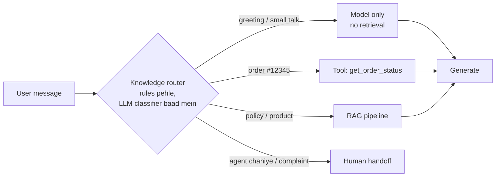
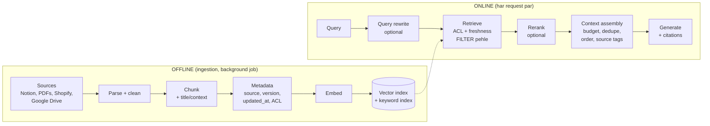
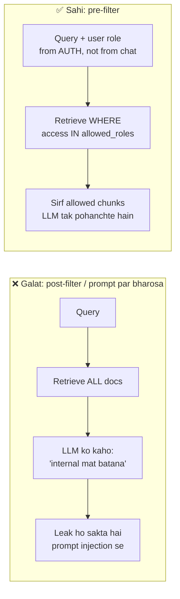

# M9.2 · Context & Knowledge Architecture

> **Outcome:** Wo **knowledge layer** design karna jo model ko **sahi information, sahi waqt par** de.

Level 4 mein aap ne RAG **banana** seekha (chunking, embeddings, vector search, hybrid). Ye module
**design decisions** ke baare mein hai: knowledge kahan se aaye, kitni fresh ho, kaun kya dekh sakta hai,
aur har jawab ka source kya hai.

---

## 1. Simple samjhao

Socho model ek naya employee hai. Usse jawab dene ke liye information chahiye. Woh 5 jagah se aa sakti hai:

| Source | Misaal (employee) | AI mein |
|---|---|---|
| **Model knowledge** (parametric) | Jo usne school/college mein parha | Training data. General facts, language, reasoning |
| **Prompt / context** | Joining par haath mein di gayi 1-page guide | System prompt mein rules, chhota FAQ |
| **RAG** | Office ki library: zaroorat par kitaab nikalna | Vector/keyword search se relevant chunks |
| **Memory** | Customer ki pichli baatein yaad rakhna | User preferences, pichli conversations (DB mein) |
| **Tools / APIs** | Computer par live system check karna | Order status, stock, price (Shopify API, DB query) |

**Design ka sawal:** har tarah ki information ke liye **kaun sa source** sahi hai?

---

## 2. Knowledge kahan se aaye? (Decision table)

| Information ki qisam | Sahi source | Kyun | Galat choice ka nuqsan |
|---|---|---|---|
| General knowledge ("3ATM kya hota hai") | Model | Pehle se pata hai | RAG lagaya to faltu cost |
| Rules, persona, tone | System prompt (permanent) | Har request par chahiye | RAG se aaye to kabhi miss ho jayenge |
| Chhota, kam badalne wala data (< ~10–20 pages) | Context stuffing + prompt caching | Simple, retrieval fail ka khatra zero | Vector DB = overengineering |
| Bara ya aksar badalne wala data | **RAG** | Sirf relevant hissa bhejo | Stuffing = mehnga, slow, "lost in the middle" |
| **Live / transactional** (order status, stock, balance) | **Tool / API call** | Hamesha current | RAG mein ye **purana** hoga → galat jawab |
| User-specific (preferences, history) | Memory store (DB) | Per-user, persistent | Sab ka data mix ho sakta hai (privacy!) |
| Structured / numbers ("pichle mahine kitni sales") | SQL / analytics tool | Exact calculation | RAG numbers ko "padh" leta hai, **jod** nahi sakta |
| Relationships ("kaun sa supplier kaun se product") | Graph / SQL join | Multi-hop | Vector search relationships nahi samajhta |

> 🔑 **Sab se common galti:** live data (order status, stock, price) ko RAG mein daal dena.
> Index kal raat bana tha, stock aaj khatam ho gaya, aur bot keh raha hai "available hai".
> **Jo data minutes mein badalta hai, wo tool se aata hai, RAG se nahi.**

### 2.1 Knowledge router

Har sawal ke liye retrieval nahi chahiye. Ek chhota **router** decide karta hai ke jawab kahan se aaye:



`knowledge_pipeline.py` ka Demo 1 yahi karta hai, sirf regex rules se. Rules sastay, tez aur predictable hote hain.
LLM classifier tab lagao jab rules ke cases bohat ho jayein (M9.3 routing mein detail).

---

## 3. The full context pipeline



Har stage par ek **design decision** hai:

| Stage | Decision | Typical choice |
|---|---|---|
| **Parse** | PDF/table/scan kaise padhein? | Simple text: pypdf. Tables/scans: Docling, Unstructured, LlamaParse |
| **Chunk** | Size, overlap, structure | 300–800 tokens, headings ke hisaab se. Chunk mein doc title daalo |
| **Metadata** | Kya store karein? | `source, doc_id, version, updated_at, access, tenant_id, language` (ye **zaroori** hai) |
| **Embed** | Kaun sa model? | Multilingual chahiye? (Roman Urdu!) Cost vs quality. Embedding model badla = **poora re-index** |
| **Retrieve** | Vector, keyword ya hybrid? k kitna? | Hybrid + RRF, k = 10–20 candidates |
| **Rerank** | Lagana hai? | Quality ka masla ho to cross-encoder (e.g. bge-reranker) ya Cohere Rerank; +50–200 ms |
| **Assemble** | Kitne tokens? Order? | Budget fix karo (e.g. 1,500 tokens), best chunk shuru ya end mein (lost-in-the-middle) |
| **Generate** | Citations? Refusal? | "Sirf context se jawab do, [S1] cite karo, na mile to human" |

---

## 4. Retrieval approaches: kab kya?

| Approach | Kis mein acha | Kis mein kamzor | Kab lagao |
|---|---|---|---|
| **Vector (dense)** | Meaning, paraphrase, multilingual | Exact codes (SKU, order no., error codes), rare names | Default for natural-language sawal |
| **Keyword (BM25)** | Exact words, codes, names, acronyms | Synonyms, paraphrase | Jab data mein IDs/codes/technical terms hon |
| **Hybrid (vector + BM25 → RRF)** | Dono | Thori zyada complexity | **Production default**. Zyada tar real systems |
| **Graph (GraphRAG / knowledge graph)** | Multi-hop relationships, "sab cheezon ka summary" | Banana mehnga, maintain karna mushkil | Sirf jab relationships core hon aur hybrid fail ho |
| **SQL / structured query** | Numbers, filters, aggregation | Free text | Sales, inventory, analytics sawal |
| **Metadata filter** | Category, date, tenant, ACL | Akele kaafi nahi | **Hamesha** baqi ke saath |

**RRF (Reciprocal Rank Fusion)** kyun default hai:
vector ka score 0–1 cosine hai, BM25 ka score 0–30 kuch bhi. Inhe jodna mushkil hai. RRF sirf **rank** dekhta hai:
`score = Σ 1/(60 + rank)`. Is mein tuning ki zaroorat nahi, aur ye robust hai. Elasticsearch, OpenSearch, Weaviate aur Qdrant sab mein built-in hai.

> Demo 4 (`TW-2047`) mein dekho: exact SKU code keyword search turant pakadta hai.
> Real embedding model ke saath "SKU TW-2047" aur "TW-2041" vector space mein bohat qareeb hote hain, aur wahan galti ho sakti hai.

---

## 5. Freshness & updates

**Masla:** Policy badli, lekin index mein purani bhi pari hai. Retrieval dono la sakta hai, aur model purani wali bol deta hai.
(Demo 2a: freshness off → "3 days" wali purani policy S1 par aa gayi.)

### Update strategies

| Strategy | Kaise | Kab |
|---|---|---|
| **Full rebuild** | Raat ko poora index dobara | Chhota data (< 10k chunks), simple. Freelance projects ka default |
| **Incremental upsert** | Sirf badle hue docs re-embed (hash/`updated_at` compare) | Medium data, roz updates |
| **Event-driven (webhook / CDC)** | Shopify/Notion webhook → us doc ka re-index | Near real-time chahiye |
| **Versioning + `is_current` flag** | Purana version delete nahi, `is_current=False` | Audit chahiye ("pichle mahine bot ne kya bataya tha?") |
| **TTL / expiry** | `valid_until` metadata, expire ho to filter | Offers, sale prices, temporary notices |

> 🔑 **Rule:** Har chunk ke saath `doc_id + version + updated_at` store karo. Update par **purane chunks delete ya
> deactivate** karo. Warna "zombie chunks" reh jaate hain. Ye production RAG ka #1 silent bug hai.

### Kitni freshness chahiye?

| Data | Kitni der purana chalega | Design |
|---|---|---|
| Return policy | Din | Nightly rebuild |
| Product description | Ghante | Webhook / hourly |
| Price, stock | **Seconds** | Tool call, RAG nahi |
| Order status | Seconds | Tool call |

---

## 6. Access control (ACL)

**Masla:** Ek hi knowledge base mein public FAQ bhi hai aur internal docs bhi (margins, SOPs).
Customer ko internal docs kabhi nahi milne chahiye.



**Rules:**
1. User ka role/tenant **authentication se** aata hai (login, phone number mapping), **user ke message se nahi**. ("Main admin hoon" likhne se koi admin nahi banta.)
2. Filter **retrieval query mein** lagao (Chroma `where`, Qdrant filter, pgvector `WHERE`), baad mein nahi.
3. Multi-tenant (bohat se clients ek system par): har client ka **alag namespace/collection** ya `tenant_id` filter. Ek client ka data doosre ko kabhi na mile.
4. Model ko jo context mila hi nahi, wo leak kar hi nahi sakta. **Yahi asal security hai** (Level 8 se link).

Demo 3a vs 3b: same sawal, customer ko margins doc nahi mila, staff ko mila.

---

## 7. Provenance (source tracking)

Har jawab ke saath pata hona chahiye: **ye kahan se aaya?**

- Context mein source tags: `[S1] ...`, `[S2] ...`
- Model ko kaho cite kare: "Return 7 din mein ho sakta hai [S1]"
- Response ke saath metadata rakho: `title, source URL, version, updated_at`
- Logs mein store karo (M9.8). Jab customer complain kare "bot ne galat bataya", to aap dekh sako **kaun sa chunk** gaya tha.

**Faide:** user trust karta hai, debugging aasaan hoti hai, hallucination pakadna aasaan hai (citation hai lekin chunk mein wo baat nahi = hallucination), aur audit/compliance ke liye record rehta hai.

---

## 8. Retrieved dynamically vs permanently in context

| Permanent (har request mein) | Dynamic (zaroorat par retrieve) |
|---|---|
| Persona, tone, safety rules | Policies, product details |
| Output format | Bare documents |
| Bohat common facts (store timing, contact) | Rare / specific info |
| Tools ki list (aur unki descriptions) | User history (sirf relevant hissa) |

**Rule of thumb:** jo **80%+ requests** mein chahiye, wo permanent (aur prompt caching se sasta, M9.5).
Jo kabhi kabhi chahiye, wo dynamic.

**Context budget** (e.g. 128k window ka matlab ye nahi ke 128k bharo):

```
System prompt + rules     ~800   (permanent, cached)
Retrieved chunks         ~1500   (dynamic, budget fixed)
Chat history (last N)     ~800   (summarize purani)
User message              ~100
Answer room               ~500
------------------------------
                         ~3700 tokens   → sasta, tez, focused
```

Zyada context = zyada cost + latency + "lost in the middle" (model beech ki information ignore karta hai). **Kam magar relevant** context aksar behtar quality deta hai.

---

## 9. Scale: kaun sa vector store?

| Scale | Choice | Notes |
|---|---|---|
| < 10k chunks, single app | Chroma (persistent) / FAISS / even numpy | Freelance MVP ke liye kaafi |
| Already Postgres use ho raha hai | **pgvector** | Ek DB kam. ACL/SQL joins aasaan. Bohat popular |
| 1M+ chunks, filters heavy, hybrid built-in | Qdrant, Weaviate, Milvus, Elasticsearch/OpenSearch | Self-host ya cloud |
| Fully managed, zero ops | Pinecone, Turbopuffer, cloud provider ke vector services | Paisa zyada, maintenance zero |

> Freelancer ke liye: **Chroma ya pgvector se shuru karo**. Vector DB badalna baad mein aasaan hai, agar aap ne retrieval ko ek interface ke peeche rakha ho (M9.7 component boundaries).

---

## 10. Industry mein kya hota hai

- **Hybrid search + reranker** most production RAG ka default hai.
- **Metadata-first design:** ingestion pipeline ka zyada waqt metadata (ACL, version, source) par lagta hai, embeddings par nahi.
- **Separate ingestion service:** Ingestion ek background job/worker hai (Airflow, cron, queue), chat API ka hissa nahi.
- **Contextual retrieval:** har chunk ke saath doc ka title/summary jodna. Anthropic ne isse retrieval failures kaafi kam hone ka result share kiya tha.
- **Agentic search for code:** coding assistants (Claude Code jaise) aksar vector index ki jagah grep/file-search tools use karte hain (M9.9 case study).
- **Eval on retrieval separately:** context precision/recall alag measure (Level 7 RAGAS), generation alag.

---

## 11. Common mistakes

| Mistake | Nuqsan | Fix |
|---|---|---|
| Live data RAG mein | Stale stock/price/status | Tool call |
| Update par purane chunks na hatana | Bot purani policy bolta hai | `doc_id+version`, upsert + delete |
| ACL prompt se ("mat batana") | Prompt injection se leak | Pre-filter in retrieval |
| Role user ke message se lena | "I am admin" se bypass | Role auth/session se |
| Sirf vector search | SKU, order no., names miss | Hybrid |
| Context bhar dena ("window bari hai") | Cost ↑ latency ↑ quality ↓ | Fixed token budget |
| Relevance threshold nahi | Irrelevant chunks (Demo 2b mein delivery doc) noise banate hain | Min score / reranker / k kam |
| Citations na rakhna | Debug aur trust dono mushkil | Source tags + log |
| Embedding model change, re-index nahi | Vectors incompatible, retrieval kachra | Model version metadata, full re-index |

---

## 12. Freelance lens 💼

- **Discovery call:** "Data kahan hai, kaun update karta hai, kitni baar?" (template section 8). Ye sawal aapki architecture **aadhi** decide kar deta hai.
- **Client ka data ganda hota hai** (scanned PDFs, WhatsApp screenshots, Excel). Ingestion/cleaning ka time **quote mein alag line** rakho. Aksar ye 30–50% kaam hota hai.
- **Client ko update ka tareeqa do:** "Google Sheet / Notion page update karo, raat ko bot khud seekh lega." Nightly rebuild aur ek simple admin process. Client aap ko har policy change par call nahi karega.
- **Multi-client setup:** Agar aap 3–4 dukanon ke bots ek server par chalao, to har client ka **alag collection** (tenant isolation). Ek client ka data doosre ke bot mein aaya to business khatam.
- **Citation dikhana selling point hai:** "Bot har jawab ka source batata hai" se client ka trust badhta hai.

---

## 13. Interview questions + model answers

**Q1. Ek support bot ke liye aap knowledge kaise design karoge?**
> Pehle information ko qisam ke hisaab se baantunga. Rules aur persona system prompt mein, aur cached. Policies aur product info RAG mein (hybrid retrieval, metadata ke saath). Order status, stock aur price live tool calls se, kyunke ye seconds mein badalte hain. User history memory store mein. Aage ek router decide karega kaun sa source chahiye, taake greeting par retrieval ka kharcha na ho.

**Q2. RAG mein access control kaise implement karoge?**
> Har chunk par ACL metadata (role/tenant/group). User ka role authentication se aata hai, chat se nahi. Retrieval query mein pre-filter lagta hai, taake unauthorized chunks LLM tak pohanchein hi nahi. Multi-tenant mein har tenant ka alag namespace. Prompt instructions ko security nahi maanunga, kyunke prompt injection se wo bypass ho jaati hain.

**Q3. Documents update hon to index fresh kaise rakhoge?**
> Har chunk ke saath `doc_id`, `version`, `updated_at` store karta hoon. Chhote data ke liye nightly full rebuild. Bade data ke liye content hash compare karke incremental upsert, aur update par purane chunks delete ya `is_current=False`. Near real-time chahiye to source ke webhooks. Jo data seconds mein badalta hai (price, stock) wo RAG mein rakhta hi nahi, tool se laata hoon.

**Q4. Vector search, keyword search, ya hybrid?**
> Default hybrid with RRF. Vector meaning aur paraphrase ke liye, BM25 exact terms (SKU, error codes, names) ke liye. RRF ko score normalization ki zaroorat nahi. Agar quality phir bhi kam ho to top-20 par reranker lagaunga, aur us ki latency (~100ms) budget mein count karunga. Graph sirf tab jab multi-hop relationships core hon.

**Q5. Context window 128k hai. Sab kuch daal kyun na dein?**
> Cost aur latency tokens ke saath badhte hain, aur models lambe context ke beech mein rakhi information miss karte hain ("lost in the middle"). Irrelevant chunks noise bante hain. Is liye fixed budget rakhta hoon, best chunks top par, dedupe karke. Long context tab theek hai jab poora document sach mein zaroori ho (contract review), aur tab bhi prompt caching ke saath.

---

## 14. Hands-on: commands

```powershell
pip install chromadb rank-bm25 ollama numpy

# Real embeddings ke liye (ek dafa):
ollama pull nomic-embed-text

python 02_context_knowledge\knowledge_pipeline.py              # Ollama embeddings
python 02_context_knowledge\knowledge_pipeline.py --offline    # bina Ollama
python 02_context_knowledge\knowledge_pipeline.py --generate   # + Groq jawab with citations
```

`--offline` aur normal mode ka output compare karo, khaas kar Demo 5 (paraphrase). Real embeddings meaning pakadte hain, hashing embedder sirf lafz.

---

## 15. Summary

- 5 knowledge sources: **model, prompt, RAG, memory, tools**. Har information ke liye sahi source chuno.
- **Live data = tool. Bara/badalta text = RAG. Chhota stable = stuffing. Rules = system prompt.**
- Pipeline: ingest → retrieve → rerank → assemble → generate. Har stage ka ek decision hai.
- **Hybrid + RRF** default hai. Graph sirf jab zaroorat ho.
- **Metadata hi asal design hai:** `source, version, updated_at, access, tenant`.
- ACL **pre-filter** se. Role auth se, chat se nahi.
- Har jawab ke saath **provenance**.
- Context ka **budget fix** karo. Zyada context ≠ behtar jawab.

**Next: M9.3 Model routing & gateways.**
