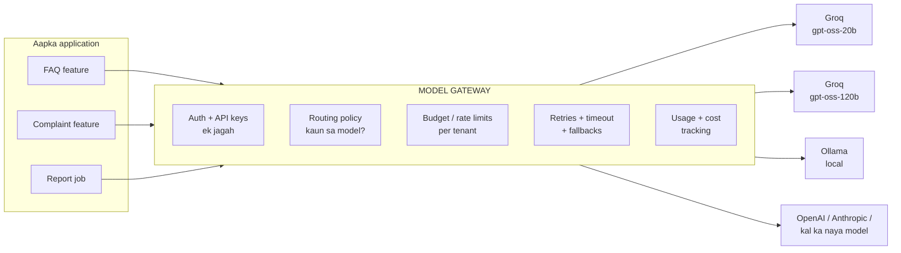
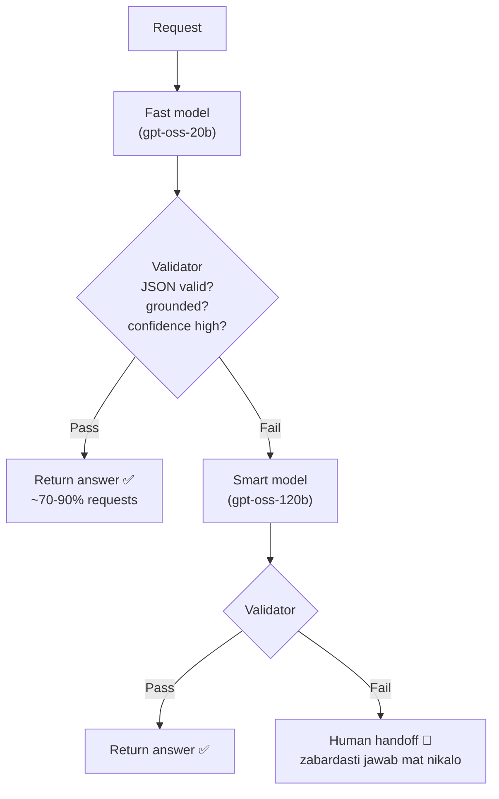
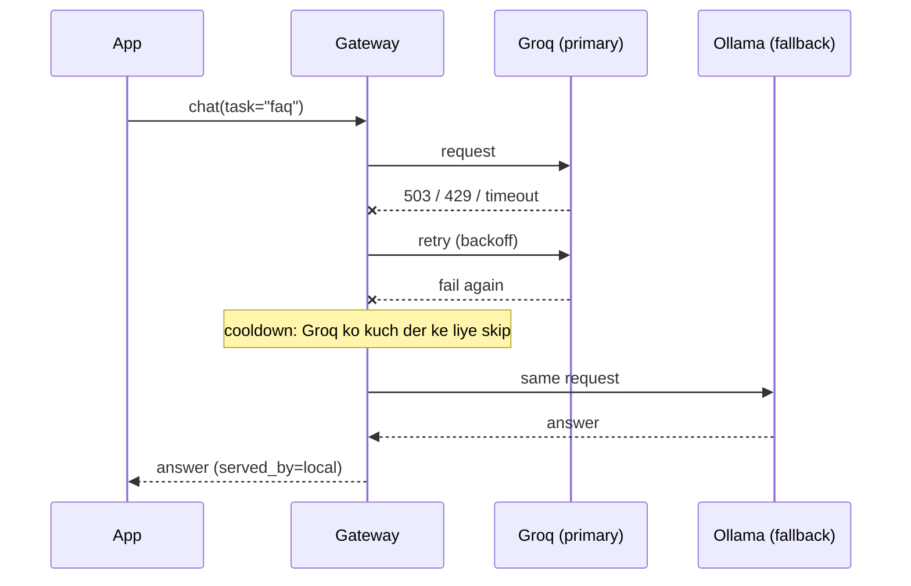

# M9.3 · Model Routing & Gateways

> **Outcome:** Application ko **ek hard-coded model** ke gird design karne se bachna.

---

## 1. Simple samjhao

Socho aapki dukan ka saara saaman **ek hi supplier** se aata hai. Supplier band = dukan band. Supplier ne rate double kiye = aap phans gaye.
Samajhdar dukandar ek **middleman/distributor** rakhta hai jo kai suppliers se maal la sakta hai.

AI mein wo middleman **model gateway** hai:



App code sirf itna kehta hai: `gateway.chat(task="faq", tenant="shop_a", messages=...)`.
Kaun sa provider, kaun sa model, retry kitni dafa, ye sab gateway ka kaam hai.

---

## 2. Gateway kya kya karta hai?

| Responsibility | Kyun zaroori | Gateway ke bina kya hota hai |
|---|---|---|
| **Provider abstraction** | Ek interface, bohat providers | Har feature mein alag SDK code; model badalna = poora code badalna |
| **Central auth / keys** | Keys ek jagah, rotate karna aasaan | Keys har jagah bikhri hui, leak ka khatra |
| **Routing** | Har task ke liye sahi model | Sab kuch mehnge model par, ya sab sastay par |
| **Retries + timeouts** | Transient errors handle | Har feature apna (ya koi nahi) retry logic |
| **Fallbacks** | Provider down → doosra | Provider outage = aapka product down |
| **Rate limits / budgets** | Ek tenant poora budget na kha jaye | Mahine ke end par surprise bill |
| **Usage + cost tracking** | Kis feature/client ne kitna kharcha kiya | Pata hi nahi chalta paisa kahan ja raha hai |
| **Logging / tracing hooks** | Observability (M9.8) | Har jagah alag logging |
| **Caching hook** | M9.5 | Duplicate calls ka paisa |

### Tools jo industry use karti hai

| Tool | Type | Kab |
|---|---|---|
| **LiteLLM** (SDK ya Proxy server) | Open-source, 100+ providers, OpenAI-compatible | **Freelance + startups ka default.** Is module ka code |
| **OpenRouter** | Hosted router, ek API key se bohat models | Jaldi prototype, ops zero (markup lagta hai) |
| **Portkey, Kong AI Gateway, Cloudflare AI Gateway** | Managed / enterprise gateways | Teams, compliance, dashboards |
| Cloud native (AWS Bedrock, Azure AI Foundry, Vertex) | Ek cloud ke andar multiple models | Jab client pehle se us cloud par ho (Level 11) |
| Apna thin wrapper | Ek class jo SDK ko wrap kare | Bohat simple app, 1 provider. Lekin interface **zaroor** banao |

> 🔑 **Minimum rule:** chahe gateway na bhi lagao, model call ko **ek function/class ke peeche** rakho.
> `llm.chat(...)`, na ke har file mein `Groq().chat.completions.create(...)`.

---

## 3. Routing: kaun sa request kaun se model ko?

### 3.1 Routing signals

| Signal | Example rule |
|---|---|
| **Task type** | classify/extract/FAQ → fast. Complaint/reasoning → smart |
| **Capability** | Image hai → vision model. Tool calling chahiye → woh model jo support kare |
| **Context length** | 200k tokens → long-context model |
| **Latency SLO** | Voice bot (< 1s) → sab se tez model, chahe thora kam smart ho |
| **Cost / tenant plan** | Free plan → fast only. Premium → smart allowed |
| **Risk** | Refund, payment, medical → strongest model **+ human approval** |
| **Language** | Urdu/Roman Urdu mein jo model behtar perform kare (eval se pata chalega!) |

### 3.2 Routing ke 3 tareeqe

| Tareeqa | Kaise | Pros | Cons |
|---|---|---|---|
| **Rules (deterministic)** | `if task == "faq": fast` | Tez, free, explainable, testable | Naye cases ke liye rules likhne parte hain |
| **Classifier (LLM ya small ML)** | Sasta model pehle intent/difficulty batata hai | Flexible | Extra call = latency + cost. Classifier bhi galat ho sakta hai |
| **Learned router** (RouteLLM jaise) | Data par trained router | Optimal cost/quality | Training data aur maintenance chahiye |

**Practical:** rules se shuru karo. Jab "unknown" bucket bara hone lage, tab sasta LLM classifier lagao.

---

## 4. Model cascades

**Idea:** zyada tar requests aasaan hoti hain. Pehle sasta model try karo, aur **sirf jab zaroorat ho** to mehnga model.



### Cascade ka hisaab

Agar fast = $1, smart = $4 (relative), aur 80% requests fast par pass:
```
Cascade cost  = 1.0 (sab fast try) + 0.2 × 4 (20% escalate) = 1.8
Smart-only    = 4.0
Saving        = 55%   (latency bhi zyada tar requests par kam)
```
Lekin agar sirf 30% pass hon: `1 + 0.7×4 = 3.8` → saving sirf 5%, aur escalated requests ki latency **double**.
**Isi liye escalation rate measure karna zaroori hai.**

### Validator kaise banayein? (sab se mushkil hissa)

| Validator | Reliability | Cost |
|---|---|---|
| **Deterministic checks**: JSON valid, required fields, length, regex (price format), banned phrases | ✅ Bohat reliable | Free |
| **Groundedness check**: jawab ki baat context mein hai? (string match / NLI / small judge) | Medium | Sasta |
| **Self-reported confidence** ("confidence": "low") | ⚠️ Kamzor (models overconfident hote hain) | Free |
| **LLM judge** (doosra model grade kare) | Acha | Extra call |
| **Logprobs** (token probabilities) | Acha signal jab provider de | Free |

> ⚠️ Sirf model ki "confidence" par cascade mat banao. **Deterministic checks pehle**, phir judge.

---

## 5. Fallbacks (aur un ka chhupa khatra)



### Fallback types

| Type | Kab |
|---|---|
| **Same model, doosra provider** (gpt-oss-20b on Groq → gpt-oss-20b on another host) | ✅ Best: quality same rehti hai |
| **Same provider, doosra model** | Jab provider up ho lekin model overloaded |
| **Different model family** | Last resort |
| **Context-window fallback** | Prompt bara ho gaya → bari window wala model |
| **Content-policy fallback** | Provider ne refuse kiya |

### ⚠️ Model switch karne ka quality risk

Model badalne par **behavior badal jata hai**, chahe "same level" ka ho:
- Prompt jo model A ke liye tune kiya tha, model B par utna acha kaam nahi karta
- JSON format, tone, language (Roman Urdu!) badal sakti hai
- Tool calling behavior alag hota hai
- Chhota fallback model = quality downgrade

**Iska ilaaj:**
1. Fallback model ko bhi **same eval set** par test karo (Level 7). Har model ka score pata ho.
2. Har model ke liye **apna prompt version** rakho agar zaroori ho.
3. Logs mein `served_by` record karo, taake fallback traffic ki quality alag dekh sako.
4. High-risk tasks ke liye fallback ki jagah **graceful degradation** (M9.6) behtar ho sakta hai: "Abhi system busy hai, team aap se rabta karegi."

---

## 6. Centralizing: kya gateway mein, kya app mein?

| Gateway mein ✅ | App mein ✅ |
|---|---|
| Provider keys, retries, timeouts, fallbacks | Business logic (order flow, refund rules) |
| Cost/usage tracking, budgets, rate limits | Prompt content (feature-specific) |
| Generic routing (by task/risk alias) | Output validation specific to feature |
| Logging/tracing hooks | UI/channel logic (WhatsApp formatting) |

> Gateway ko "smart" mat banao. Business logic gateway mein gaya to har feature uske saath tie ho jayega.

---

## 7. Code walkthrough: `gateway.py`

| Part | Kya dikhata hai |
|---|---|
| `MODEL_LIST` | Aliases: `fast`, `smart`, `local`. App sirf alias jaanti hai |
| `FALLBACKS` | `fast → smart → local` |
| `Router(num_retries, timeout, allowed_fails, cooldown_time)` | Retry + mini circuit breaker (M9.6) |
| `choose_route()` | Rule-based routing with **reason** (explainable) |
| `ModelGateway.chat()` | Budget guard → route → LiteLLM → served_by |
| `UsageLedger` | LiteLLM callback se per tenant/feature cost + latency |
| `cascade()` | fast → deterministic validate → smart → human |
| Demo 5 | Budget khatam → graceful downgrade; high-risk → block |

Offline: `--mock` LiteLLM ke `mock_response` aur `mock_testing_fallbacks` use karta hai, koi API call nahi.

---

## 8. Industry mein kya hota hai

- Bari companies ka **internal AI platform team** ek gateway chalati hai. Sab product teams usi ko call karti hain.
- **LiteLLM Proxy** ek alag server ke taur par chalta hai (Docker). Har app OpenAI SDK se usi ko call karti hai, aur virtual keys per team/client hoti hain.
- **Cost attribution:** har call par `tenant/feature/user` tag, aur finance dashboards per customer margin dikhate hain.
- **Model migrations:** naya model aaye → shadow traffic (dono ko bhejo, user ko purana dikhao) → eval compare → gradual rollout (5% → 50% → 100%).
- **Multi-provider for availability:** critical apps 2 providers par same model rakhte hain.

---

## 9. Common mistakes

| Mistake | Fix |
|---|---|
| Har file mein provider SDK direct | Ek gateway/wrapper |
| Fallback model kabhi test nahi kiya | Same eval set har model par |
| Sab requests mehnge model par "safe rehne ke liye" | Routing + cascade, measure karo |
| Cascade sirf self-confidence par | Deterministic + groundedness checks |
| Timeout set hi nahi kiya | Har call par timeout (e.g. 20–30s) |
| Retry non-retryable errors par (400 bad request) | Sirf 429/5xx/timeouts retry |
| Cost track nahi | Per tenant/feature ledger |
| `served_by` log nahi | Fallback traffic ki quality alag analyze nahi ho sakti |

---

## 10. Freelance lens 💼

- **Client ko kabhi ek model se lock mat karo.** Proposal mein likho: "Model-agnostic design. Kal agar sasta/behtar model aaye to config change se switch ho jayega." Ye professional lagta hai aur sach bhi hai.
- **Multiple clients = per-client budget.** Ek client ka bot loop mein phans gaya to doosron ka budget na kha jaye. Gateway budget guard isi ke liye hai.
- **Monthly cost report** per client (ledger se) bhejo. Transparency se trust banta hai, aur usage-based billing bhi ho sakti hai.
- **Groq free tier rate limits** production ke liye kaafi nahi hote. Fallback (Ollama, ya doosra provider) **pehle din se** lagao, warna peak time par bot chup ho jayega.
- Aap akele ho, is liye **LiteLLM SDK** (library) kaafi hai. Proxy server tab, jab 3+ apps/clients ek hi gateway use karein.

---

## 11. Interview questions + model answers

**Q1. Model gateway kya hai aur kyun chahiye?**
> Application aur model providers ke beech ek abstraction layer. Ye provider differences chhupata hai, aur auth, routing, retries, timeouts, fallbacks, rate limits, budgets aur usage/cost tracking ko centralize karta hai. Faida: model ya provider badalna config change ban jata hai, outage ka asar kam hota hai, aur cost per feature/tenant visible hoti hai. Main business logic gateway se bahar rakhta hoon.

**Q2. Cascade kaise design karoge, aur kab ye faida nahi deta?**
> Fast model pehle, phir validator (deterministic checks: schema, required fields, groundedness; phir optional judge), fail par stronger model, aur woh bhi fail ho to human. Ye tab faida deta hai jab zyada tar traffic aasaan ho, yani pass rate high ho. Pass rate kam ho to cost saving khatam ho jaati hai aur escalated requests ki latency double ho jaati hai. Is liye escalation rate aur per-tier quality monitor karta hoon.

**Q3. Provider fallback ke risks kya hain?**
> Behavior aur quality badal jaati hai: formatting, tone, language, tool calling. Prompt ek model ke liye tuned hota hai. Main fallback models ko bhi same eval set par test karta hoon, `served_by` log karta hoon, aur jahan possible ho same model doosre provider par fallback rakhta hoon. High-risk flows mein weaker model ki jagah graceful degradation ya human escalation behtar hai.

**Q4. Ek multi-tenant SaaS mein ek customer saara budget kha raha hai. Kya karoge?**
> Gateway par per-tenant rate limits aur budgets. Soft limit par cheaper model ya reduced features (degrade), hard limit par block karke clear message. Usage alerts at 80%. Ye logic gateway mein hai taake har feature ko alag se implement na karna pare.

**Q5. Routing rules se karoge ya LLM classifier se?**
> Rules se shuru, kyunke wo free, fast, explainable aur unit-testable hain. Jab rules "unknown" cases zyada chhorne lagein, tab sirf unke liye sasta LLM classifier. Classifier ki latency/cost budget mein count karunga aur uska accuracy eval set par measure karunga.

---

## 12. Hands-on

```powershell
pip install litellm
python 03_model_routing_gateway\gateway.py --mock    # offline
python 03_model_routing_gateway\gateway.py           # real Groq (+ Ollama fallback agar chal raha ho)
```

## 13. Summary

- **Kabhi ek model hard-code mat karo.** Gateway/wrapper ke peeche rakho.
- Gateway: abstraction, keys, routing, retries, timeouts, fallbacks, budgets, cost tracking.
- Routing signals: task, capability, context length, latency, cost, risk, language.
- **Rules → classifier → learned router**: is order mein.
- **Cascade** tab faida deta hai jab pass rate high ho. Validator deterministic pehle.
- Fallback = **quality risk**. Har model ko eval karo, `served_by` log karo.

**Next: M9.4 Latency & inference optimization.**
