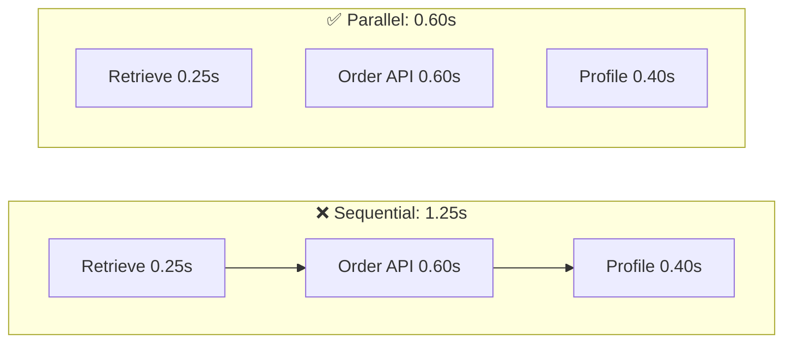

# M9.4 · Latency & Inference Optimization

> **Outcome:** Pehchanna ke AI app **kahan** slow hai, aur sahi optimization chunna,
> bajaye is ke ke seedha "bara server / mehnga plan" le lo.

---

## 1. Simple samjhao

Restaurant mein khana late aaya. Kyun? Ho sakta hai:
- Order lene wala late aaya (network)
- Chef ne saaman dhoondne mein waqt lagaya (retrieval)
- Chef ne ek ek dish **baari baari** banayi jab ke 3 cooks saath bana sakte the (sequential vs parallel)
- Dish hi bohat bari order hui (output tokens)

Agar aap **bina dekhe** naya chula khareed lo (bara GPU/model), to ho sakta hai masla waiter ka tha.
**Pehle naapo (measure), phir theek karo.**

---

## 2. Latency ke components

```mermaid
gantt
    title Ek WhatsApp request ka waterfall (sequential, ~2.1s)
    dateFormat X
    axisFormat %L ms
    section Network
    Webhook + parse        :0, 50
    section Retrieval
    Vector + BM25          :50, 300
    section Tools
    Order status API       :300, 900
    Customer profile       :900, 1300
    section LLM
    TTFT (prefill)         :1300, 1500
    Generate tokens        :1500, 1820
    section Network
    Send reply             :1820, 2120
```



| Component | Kya hai | Kis par depend karta hai |
|---|---|---|
| **Network / channel** | Client ↔ server ↔ provider. WhatsApp webhook, Meta API | Region, provider, channel |
| **Retrieval** | Vector/keyword search, reranker | Index size, DB, reranker |
| **Tool calls** | External APIs (Shopify, DB) | Woh API kitni tez hai |
| **Queue time** | Provider ke paas request line mein | Provider load, aapka tier |
| **TTFT** (Time To First Token) | Prefill: model poora input "padhta" hai | **Input tokens**, model size |
| **Generation / decode** | Har output token ek ek karke | **Output tokens** (reasoning samet) ÷ tokens/sec |
| **Multiple LLM calls** | Classifier → main → judge | Kitni calls **sequential** hain |

### Do important terms
- **TTFT**: pehla token kab aaya. Ye input size aur queue par depend karta hai.
- **TPOT / ITL** (time per output token): har agla token kitni der mein. Total ≈ TTFT + output_tokens × TPOT.

> 🔑 **Output tokens latency ka sab se bara driver hote hain.** Input tokens ek saath (parallel) process hote hain;
> output tokens **ek ek karke**. 1,000 input tokens < 1,000 output tokens (waqt mein, bohat zyada).

---

## 3. Measure first: percentiles

Average jhoot bolta hai. 100 requests: 95 ka 1s, 5 ka 20s → average 1.95s ("theek hai") lekin 5% users naraz hain.

| Metric | Matlab | Target example |
|---|---|---|
| p50 | Aadhe users is se tez | 1.5s |
| p95 | 95% users is se tez | 4s |
| p99 | Worst 1% ko chhor kar | 8s |

**Har span alag naapo** (`latency_lab.py` ka `Trace.span`, production mein OpenTelemetry/Langfuse, M9.8). Tabhi pata chalega ke bottleneck kahan hai.

---

## 4. Optimization toolbox: symptom → fix

| Symptom (measurement se) | Pehla fix | Phir |
|---|---|---|
| TTFT zyada, input bara | **Context kam karo** (RAG budget, history summarize) | Prompt caching (M9.5) |
| Generation lambi | **Output chhota** (max_tokens, "60 words mein"), reasoning_effort kam | Chhota/tez model |
| Bohat se tool calls sequential | **Parallel** (`asyncio.gather`) | Pre-fetch / cache tool results |
| Bohat si LLM calls sequential | **Merge** (ek structured call), ya deterministic code se replace | Parallel calls |
| Har request same jawab | **Cache** (M9.5) | |
| Model hi slow (frontier, 50 tok/s) | **Chhota model** jo eval pass kare | Tez provider (Groq, Cerebras) |
| Queue time / 429 | Rate limit plan, retries + fallback (M9.6) | Doosra provider, higher tier |
| Kaam user ko wait karwane layak nahi | **Async job** (M9.7): "report 2 min mein bhejta hoon" | |
| Perceived slow (lekin total theek) | **Streaming**, typing indicator, quick ack | |

---

## 5. Streaming: perceived latency

Total time same, lekin user ko **pehla lafz** 0.3s mein dikh jaye to wo system ko tez samajhta hai.

| Channel | Streaming? | Perceived latency ka ilaaj |
|---|---|---|
| Web chat, app | ✅ SSE / WebSocket | Token-by-token stream |
| **WhatsApp, SMS, email** | ❌ (poora message jata hai) | **Typing indicator**, foran ek chhota ack ("Order check kar raha hoon..."), jawab chhote rakho |
| Voice | ✅ (critical) | Stream LLM → TTS sentence by sentence |

> ⚠️ **Reasoning models + streaming:** model pehle "sochta" hai (reasoning tokens user ko nahi dikhte). Pehla **visible** token reasoning ke baad aata hai. `reasoning_effort="low"` aur reasoning stream na karna zaroori hai. (EXP 2 dekho.)

---

## 6. Parallelize independent work



**Rule:** jo steps ek doosre ke output par depend **nahi** karte, wo saath chalao. Total = sab se slow step.

**Unnecessary sequential LLM calls:**
```
❌ call 1: intent?  →  call 2: sentiment?  →  call 3: language?  →  call 4: answer
✅ call 1: {intent, sentiment, language} ek JSON mein  →  call 2: answer
✅✅ intent regex/rules se (0 ms)  →  ek LLM call
```
Har LLM call = TTFT + generation + network. **Har call ko apni jagah kamani chahiye.**

---

## 7. Smaller / faster models

- Chhota model **tab** use karo jab woh aapke **eval set** par pass kare (sirf "lagta hai" nahi).
- Classification, extraction, routing, short FAQ jaise narrow tasks ke liye chhote models aksar kaafi hote hain.
- Inference provider bhi matter karta hai: same open model ki speed providers mein **10x** tak alag ho sakti hai (Groq/Cerebras custom hardware).
- Cascade (M9.3): zyada tar requests chhote model par, mushkil wali bare par.

---

## 8. Context reduction, batching, inference optimizations

### Context reduction
- Retrieved chunks ka **fixed budget** (M9.2)
- Chat history: last N turns + purani ka **summary**
- System prompt se faltu examples hatao (har token har request par bill hota hai)
- Tool descriptions chhoti karo (agents mein 20 tools ki descriptions = hazaron tokens)

### Batching
| Type | Kya | Kab |
|---|---|---|
| **Provider Batch API** | Bohat si requests ek file mein, 24h mein results, **~50% sasta** (Groq, OpenAI, Anthropic sab dete hain) | Offline: nightly summaries, bulk classification, evals |
| **Continuous batching** (server-side) | vLLM/TGI jaise servers bohat se users ki requests GPU par saath process karte hain | Jab **aap khud** model host karo |
| **Client-side micro-batching** | 50 chhote items ek prompt mein | Bulk classification (ek ek call se sasta/tez) |

### Inference-service optimizations (self-hosting par, Level 10/11 mein detail)
| Technique | Asar |
|---|---|
| **Quantization** (8-bit/4-bit) | Kam memory, tez, thora quality loss |
| **KV cache / prefix caching** | Repeat prefix (system prompt) dobara compute nahi |
| **Speculative decoding** | Chhota model draft kare, bara verify → 2–3x tez generation |
| **Serving engines** (vLLM, SGLang, TensorRT-LLM) | Continuous batching + paged attention |
| **Region/colocation** | Server aur provider ek region mein → network kam |

> Managed API (Groq/OpenAI) use kar rahe ho to ye provider ka kaam hai. Aapke haath mein: **tokens, calls, parallelism, caching, model choice**.

---

## 9. Throughput, latency, utilization at scale

- **Latency:** ek request kitni der mein
- **Throughput:** system per second kitni requests/tokens handle karta hai
- **Utilization:** resources (GPU, workers, rate limit) kitna use ho rahe hain

**Little's Law:** `concurrency = arrival rate (QPS) × latency`
```
Peak 2 req/s × 3s latency = 6 requests ek waqt mein chal rahi hain
→ 6+ async workers/connections chahiye
→ Provider limits: 2 × 60 = 120 RPM, aur 120 × 3,000 tokens = 360k TPM
```

**Trade-off:** self-hosted GPU par batch size badhao → throughput ↑ (sasta per token) lekin har user ki latency ↑.
Utilization 100% ke qareeb jaye to queue time **exponentially** badhta hai. ~70–80% par plan karo.

> 🔑 Rate limits (RPM/TPM) **managed APIs ka asal capacity limit** hain. Peak traffic ka hisaab lagao **pehle**, launch ke baad nahi.

---

## 10. Latency budget (design doc mein likho)

WhatsApp bot, target p95 < 4s:

| Component | Budget |
|---|---|
| Webhook + parse | 100 ms |
| Retrieval + tools (parallel) | 700 ms |
| LLM TTFT | 500 ms |
| LLM generation (≤ 200 output tokens) | 800 ms |
| Send reply (Meta API) | 400 ms |
| **Buffer** | 1,500 ms |
| **Total p95** | **4,000 ms** |

Har component ka budget hai. Koi naya feature (reranker +150ms) aaye to **kis ka budget kam hoga**, ye faisla karna parta hai.

---

## 11. Industry mein kya hota hai

- **Latency SLOs** per feature (chat p95 < 3s, autocomplete p95 < 300ms).
- **Tracing har jagah** (OpenTelemetry). Har span ka p95 dashboard par.
- **Streaming everywhere** jahan UI allow kare. Voice agents sentence-level streaming karte hain.
- **Speculative / optimistic execution:** user type kar raha ho to retrieval pehle shuru kar do.
- **Small model for the hot path:** user-facing path par tez model, background mein bara model (quality checks, summaries).
- **Batch API for offline workloads** taake cost half ho.

---

## 12. Common mistakes

| Mistake | Fix |
|---|---|
| Bina measure kiye "bara server" / "tez model" | Span-level tracing, phir fix |
| Sirf average latency | p95/p99 |
| Har cheez sequential `await` | Independent steps `asyncio.gather` |
| 4 LLM calls jahan 1 kaafi | Merge, ya rules se replace |
| `max_tokens` set nahi, model 800 tokens likh raha hai | Output limit + "concise" instruction |
| Reasoning effort high by default | Task ke hisaab se low/medium |
| WhatsApp par lamba wait, koi feedback nahi | Typing indicator / quick ack |
| Rate limits ka hisaab nahi | Little's Law + TPM calc pehle |

---

## 13. Freelance lens 💼

- Client ko kabhi "fast hoga" mat bolo. **Number do**: "p95 under 4 seconds on WhatsApp". Aur latency budget table proposal mein daalo.
- **Groq choose karne ki ek wajah speed hai.** Client ko ye selling point ke taur par bata sakte ho, lekin rate limits ka plan saath do.
- Client ki shikayat "bot slow hai" → **trace dikhao**: "Shopify API 1.2s le raha hai, model sirf 0.5s." Is se masla clearly samajh aata hai.
- Bulk kaam (purane 5,000 customer messages classify karna) **Batch API** se karo aur client ka bill aadha karo.

---

## 14. Interview questions + model answers

**Q1. Aapka RAG chatbot slow hai (p95 9s). Kaise debug karoge?**
> Pehle har stage ko trace karunga: retrieval, reranker, tool calls, TTFT, generation, network. Phir p95 per span dekhunga. Agar generation zyada hai to output tokens kam karunga (max_tokens, concise instructions, reasoning effort). Agar TTFT zyada hai to context kam karunga ya prompt caching lagaunga. Sequential independent calls ho to parallelize karunga. Faltu LLM calls merge karunga. Jo wait karne layak nahi wo async job mein bhejunga. Model ya infra tab upgrade karunga jab measurement ye dikhaye ke wahi bottleneck hai.

**Q2. TTFT aur total latency mein kya farq hai? Kab kya optimize karoge?**
> TTFT pehle token tak ka waqt hai, jo prefill aur queue par depend karta hai, yani input size par. Total mein output generation bhi shamil hai. Streaming UI mein perceived speed TTFT se aati hai, is liye wahan context reduction aur caching. Non-streaming channels (WhatsApp, API, JSON output) mein total matter karta hai, is liye output tokens kam karna sab se bara lever hai.

**Q3. Streaming kab kaam nahi karti?**
> Jab channel support na kare (WhatsApp, SMS, email), jab poora structured output chahiye (JSON parse karna hai), ya jab output guardrail poore jawab par lagani ho, kyunke stream ho chuka text wapas nahi liya ja sakta. Aise mein typing indicator, quick acknowledgement, ya chunked messages use karta hoon.

**Q4. Throughput vs latency ka trade-off samjhao.**
> Self-hosted inference mein batch size badhane se GPU utilization aur throughput badhte hain aur cost per token kam hoti hai, lekin har request ki latency badh jaati hai. Utilization 100% ke qareeb queueing delay tezi se badhta hai. Is liye latency SLO ke hisaab se batch size aur headroom (~70–80% utilization) set karte hain. Managed APIs mein ye provider handle karta hai, aur hamari capacity rate limits (RPM/TPM) se set hoti hai, jinhe Little's Law se plan karte hain.

---

## 15. Hands-on

```powershell
python 04_latency_optimization\latency_lab.py --mock   # simulation
python 04_latency_optimization\latency_lab.py          # real Groq
```
Mock aur real ke numbers compare karo. Real Groq par kaun sa component sab se bara nikla?

## 16. Summary

- **Pehle naapo** (span-level, p95), phir optimize.
- Latency = network + retrieval + tools + TTFT + **generation** (output tokens sab se bara driver).
- Streaming = perceived latency. WhatsApp par typing indicator/ack.
- Independent kaam **parallel**. Faltu LLM calls **merge ya hatao**.
- Chhota model tab, jab eval pass kare. Context kam karo. Offline kaam Batch API se.
- Little's Law se capacity aur rate limits plan karo.
- Har component ka **latency budget** design doc mein.

**Next: M9.5 Caching architecture.**
