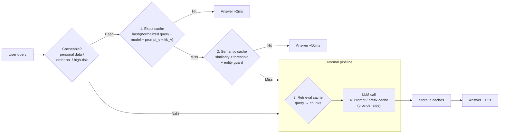

# M9.5 · Caching Architecture

> **Outcome:** Caching ko **architectural optimization** ki tarah use karna, aakhir mein jod diya gaya "afterthought" nahi.

---

## 1. Simple samjhao

Dukan par roz 50 log poochte hain "return policy kya hai?". Har dafa owner ko phone karke poochna (LLM call) mehnga aur slow hai.
Samajhdar salesman jawab **yaad** rakhta hai (cache). Lekin:
- Policy badal gayi to purana jawab **bhoolna** parega (invalidation)
- "Mera order kahan hai?" ka jawab har customer ka **alag** hai, use yaad rakh kar doosre ko batana **ghalat** hai (cacheability)
- "Lahore delivery?" aur "Karachi delivery?" **milte julte** hain, lekin jawab alag hai (semantic cache ka khatra)

---

## 2. AI system mein 4 (+1) caches



| Cache | Kya store hota hai | Key | Kahan | Faida | Khatra |
|---|---|---|---|---|---|
| **Exact response cache** | Poora jawab | Normalized query + model + prompt version + KB version + params | Redis / diskcache | 0 cost, ~ms latency | Kam hits (wording same honi chahiye) |
| **Semantic cache** | Poora jawab | Query embedding (similarity) | Redis vector, Qdrant, pgvector | Paraphrases par bhi hit | **Galat jawab** (false positive) |
| **Retrieval cache** | Retrieved chunk IDs | Normalized query + index version | Redis | Embedding + search skip | Stale chunks agar invalidation na ho |
| **Prompt / prefix cache** | Model ka internal compute (KV cache) for same prompt **prefix** | Provider automatically (exact prefix match) | **Provider side** (Groq, OpenAI, Anthropic) | Input tokens sastay (e.g. 50% off), TTFT kam | Prefix badla = cache toota |
| (+) **Tool result cache** | API response (product details, exchange rate) | Tool + args | Redis | External API calls kam | Stale data (short TTL) |

> 🔑 **Prompt caching aur response caching alag cheezein hain.** Prompt caching mein model **phir bhi chalta hai**
> (naya jawab banta hai), bas repeated prefix ka input sasta/tez ho jata hai. Response caching mein model **chalta hi nahi**.

---

## 3. Kya cache karna safe hai?

| ✅ Safe (generally) | ⚠️ Careful (short TTL / guard) | ❌ Kabhi nahi |
|---|---|---|
| Public FAQ jawab | Product price / stock (minutes) | Order status, account balance |
| Static policy | Tool results | Kuch bhi jis mein **personal data** ho |
| Embeddings of documents | Semantic matches | User-specific recommendations (dusre user ko) |
| Classification of same text | Search results | High-risk actions (refund, payment) |
| Translations of fixed text | | Jab `temperature` high ho aur variety chahiye ho |

**Cacheability gate** (Layer 0) code mein pehli line honi chahiye: `if not is_cacheable(query): skip cache`.

### Cache key mein kya hona chahiye?

Har wo cheez jo **jawab badal sakti hai**:
```
key = hash( normalize(query)
          + model_name           # model badla -> jawab badla
          + prompt_version       # prompt badla -> jawab badla
          + kb_version           # policy badli -> jawab badla
          + tenant_id            # shop A ka jawab shop B ko NAHI
          + language / params )  # temperature, output format
```
> ⚠️ `tenant_id` key mein bhool gaye = ek client ka jawab doosre client ke customer ko. **Data leak.**

---

## 4. Expiration & invalidation

> "There are only two hard things in Computer Science: cache invalidation and naming things." (Phil Karlton)

| Strategy | Kaise | Kab |
|---|---|---|
| **TTL** (time-to-live) | Har entry X der baad expire | Har cache par **hamesha** (safety net) |
| **Version in key** | `kb_version` bump → purani keys khud miss | Policy/KB update. **Sab se simple aur reliable** |
| **Explicit delete / purge** | Update event par related keys delete | Jab pata ho kaun si entries affected hain |
| **Event-driven** | Webhook (Shopify product update) → us product ki entries purge | Near real-time data |
| **Stale-while-revalidate** | Purana jawab do, background mein refresh | Latency critical, thori staleness chalegi |

TTL guidelines:

| Data | TTL |
|---|---|
| Static policy FAQ | 1–7 din + version key |
| Product description | Ghante |
| Price / stock | 1–5 minutes (ya cache nahi) |
| Exchange rate / weather | Minutes |
| Personal / order | ❌ |

---

## 5. Semantic caching

**Idea:** "What's your return policy?" aur "Can I return my watch?" ka jawab same hai. Embedding similarity ≥ threshold → cached jawab.

### Asal khatra: false positives

`caching_lab.py` EXP 2 ka real output:
```
❌ 'How long does delivery take in Karachi?' matched 'how long does delivery take in lahore'
   -> 'Lahore mein 1-2 working days.'        (sim=0.81)
❌ 'What is the price of TW-2041?' matched 'What is the price of TW-2047?'
   -> 'TW-2047 Ravi Classic: Rs 5,999.'       (sim=0.86)
```
Embeddings **topic** pakadte hain, **details** nahi. Ek SKU number ya city ka farq similarity par bohat kam asar dalta hai, lekin jawab poora badal deta hai.

### Guardrails for semantic cache

1. **Entity guard:** numbers, SKUs, cities, dates, names dono queries mein **same** hone chahiye (EXP 3: wrong hits 9 → 0).
2. **High threshold** (0.9+) se shuru karo, phir data dekh kar kam karo.
3. **Category allowlist:** sirf FAQ jaise categories par semantic cache. Orders/complaints par nahi.
4. **Shadow mode pehle:** semantic cache lookup karo, lekin jawab mat do. Sirf log karo "agar dete to kya dete", phir galti rate check karo.
5. **Feedback se purge:** thumbs-down aaya to woh entry delete.

### Threshold trade-off (EXP 4)

```
threshold  hit rate  wrong hits        (offline embedder; Ollama par numbers alag honge)
     0.70       80%           9
     0.85       75%           3
     0.90       73%           0
```
Kam threshold → zyada hits → zyada galat jawab. **Threshold aapke data aur embedding model par depend karta hai**, koi universal number nahi.

> 🔑 **Exact cache ne akele 72% hit rate diya** (normalization ke saath). Semantic ne sirf 3–8% extra diya,
> aur risk ke saath. Bohat se systems mein **exact + normalization kaafi hai**.

---

## 6. Freshness ↔ quality ↔ latency ↔ cost

| Zyada aggressive caching | Kam caching |
|---|---|
| ✅ Sasta, tez | ✅ Hamesha fresh, personalized |
| ❌ Stale jawab ka risk | ❌ Mehnga, slow |
| ❌ Personalization kam | |
| ❌ Galat semantic hits | |

**Faisla data ki nature se:** FAQ = aggressive. Price/stock = short TTL. Orders = no cache.

---

## 7. Measure the hit rate (assume mat karo!)

Track karo (M9.8):
- **Hit rate per layer** (exact, semantic, retrieval)
- **Cost saved** = hits × avg LLM cost
- **Latency saved**
- **Wrong-hit rate** (thumbs-down on cached answers, ya sampled manual review)
- **Cache size / memory**
- **Prompt cache hit** (provider response mein `cached_tokens` field)

> ⚠️ **Real traffic ka long tail:** lab mein 72% exact hits isliye aaye kyunke humne repeated sawal simulate kiye.
> Real support traffic mein har customer apne andaaz mein likhta hai, aur exact hit rate **10–30%** bhi ho sakta hai.
> **Launch se pehle logs se andaaza lagao:** pichle mahine ke messages normalize karke dekho kitne duplicate hain.

**Kab caching ka faida NAHI:** har query unique ho (coding assistant, research agent), ya personalized ho, ya cache ka overhead (semantic embedding call ~50ms) LLM ki bachat se zyada ho.

---

## 8. Provider prompt caching: prompt ko kaise structure karein

```
✅ CACHE-FRIENDLY                          ❌ CACHE TOOTEGA
┌─────────────────────────────┐            ┌─────────────────────────────┐
│ System prompt (fixed)       │ ← cached   │ "Today is 2026-10-25 14:03" │ ← har dafa alag!
│ Rules + tools (fixed)       │ ← cached   │ System prompt               │
│ FAQ / policies (fixed)      │ ← cached   │ "Customer name: Ali"        │
├─────────────────────────────┤            │ FAQ                         │
│ Chat history (dynamic)      │            │ ...                         │
│ User message (dynamic)      │            └─────────────────────────────┘
└─────────────────────────────┘
```
- **Static pehle, dynamic baad mein.** Caching exact **prefix** match par hoti hai.
- Timestamps, user names, random IDs ko static hisse se bahar rakho.
- Tools ki list ka order fixed rakho.
- EXP 6: 2,300 static + 550 dynamic tokens → ~40% input saving.

---

## 9. Industry mein kya hota hai

- **Redis** sab se common response/semantic cache store hai (Redis vector search, RedisVL `SemanticCache`). GPTCache jaisi libraries bhi.
- **LiteLLM** mein built-in caching (Redis, semantic) gateway level par (M9.3). Har feature ko alag implement nahi karna parta.
- **Prompt caching** ab har bara provider deta hai, aur long system prompts/agents mein cost ka bara hissa bachata hai.
- **Embeddings cache:** same document dobara embed nahi hota (content hash → vector).
- Teams cache ko **feature flag** ke peeche rakhti hain, taake masla ho to foran band kiya ja sake.

---

## 10. Common mistakes

| Mistake | Nuqsan | Fix |
|---|---|---|
| Key mein `prompt_version`/`kb_version` nahi | Prompt/policy badli, purana jawab chalta raha | Version in key |
| Key mein `tenant_id` nahi | Cross-client leak | Tenant in key |
| Order status cache | Galat status | Cacheability gate |
| Semantic cache bina entity guard | TW-2041 ka sawal, TW-2047 ka jawab | Entity guard + high threshold |
| TTL nahi | Galat jawab hamesha ke liye | Har entry par TTL |
| Hit rate measure nahi | "Cache lagaya, faida pata nahi" | Metrics |
| Dynamic cheez prompt ke shuru mein | Prompt caching kabhi hit nahi | Static first |
| Thumbs-down cached answer bhi cache mein reh gaya | Galti baar baar | Feedback → purge |

---

## 11. Freelance lens 💼

- Client se pehle **purane chat logs** maango (WhatsApp export). Normalize karke duplicate % nikalo. Ye aapke proposal mein **hard number** ban jata hai: "~40% sawal repeat hain → cache se running cost ~40% kam."
- Freelance MVP mein **exact cache + normalization + version key + TTL** kaafi hai. Semantic cache sirf tab, jab volume bara ho aur logs se faida prove ho.
- **Multi-client setup:** key mein `tenant_id` **zaroor**. Ye aapka sab se bara reputational risk hai.
- Client policy update kare to cache clear kaise hoga? Simple admin step do: "Sheet update → bot ka `kb_version` khud badh jayega" (nightly job), ya ek "Refresh bot" button/command.

---

## 12. Interview questions + model answers

**Q1. LLM app mein kaun kaun se caches ho sakte hain?**
> Exact response cache (normalized query + versions key), semantic cache (embedding similarity), retrieval cache (query → chunks), provider-side prompt/prefix cache (repeated prefix ka compute), aur tool result cache. Har ek ka faida, key design, TTL aur risk alag hai. Response caches model call skip karte hain; prompt cache model chalata hai lekin input sasta aur tez karta hai.

**Q2. Semantic caching ke risks aur mitigations?**
> Sab se bara risk false positives hain: milte julte sawal jin ke jawab alag hain (city, SKU, date, negation). Mitigation: high threshold se shuru, entity guard (numbers/IDs/entities match hon), sirf safe categories (FAQ), personal queries bypass, shadow mode mein pehle evaluate, aur thumbs-down par entry purge. Aur measure karta hoon ke exact cache ke upar semantic ka actual incremental hit rate kitna hai, aksar wo chhota hota hai.

**Q3. Cache invalidation kaise karoge jab knowledge base update ho?**
> Key mein `kb_version` aur `prompt_version` rakhta hoon. Update par version bump, to purani entries khud miss ho jaati hain. Har entry par TTL safety net ke taur par. Near real-time data ke liye event-driven purge (webhook). Jo data seconds mein badalta hai (stock, order status) usse cache hi nahi karta.

**Q4. Prompt caching se faida kaise uthaoge?**
> Prompt ko static-first structure karta hoon: system prompt, tools aur fixed knowledge shuru mein, aur dynamic history/user message aakhir mein. Static hisse mein timestamps ya user-specific cheezein nahi. Phir provider response ke `cached_tokens` se actual hit rate verify karta hoon.

---

## 13. Hands-on

```powershell
pip install diskcache
python 05_caching\caching_lab.py            # Ollama embeddings
python 05_caching\caching_lab.py --offline
```
Ollama ke saath EXP 4 ka threshold sweep dobara dekho. Real embeddings mein "safe" threshold kya nikla?

## 14. Summary

- Caches: **exact, semantic, retrieval, prompt/prefix, tool**. Har ek alag problem solve karta hai.
- Pehle **cacheability gate**: personal/order/high-risk = no cache.
- Key mein **model + prompt_version + kb_version + tenant**.
- Invalidation: **version in key + TTL**. Live data ko cache mat karo.
- Semantic cache = **entity guard + high threshold + shadow mode**. Aksar exact + normalization hi kaafi hai.
- Prompt caching: **static pehle, dynamic baad mein**.
- **Hit rate aur wrong-hit rate naapo**, assume mat karo.

**Next: M9.6 Reliability, guardrails & graceful degradation.**
