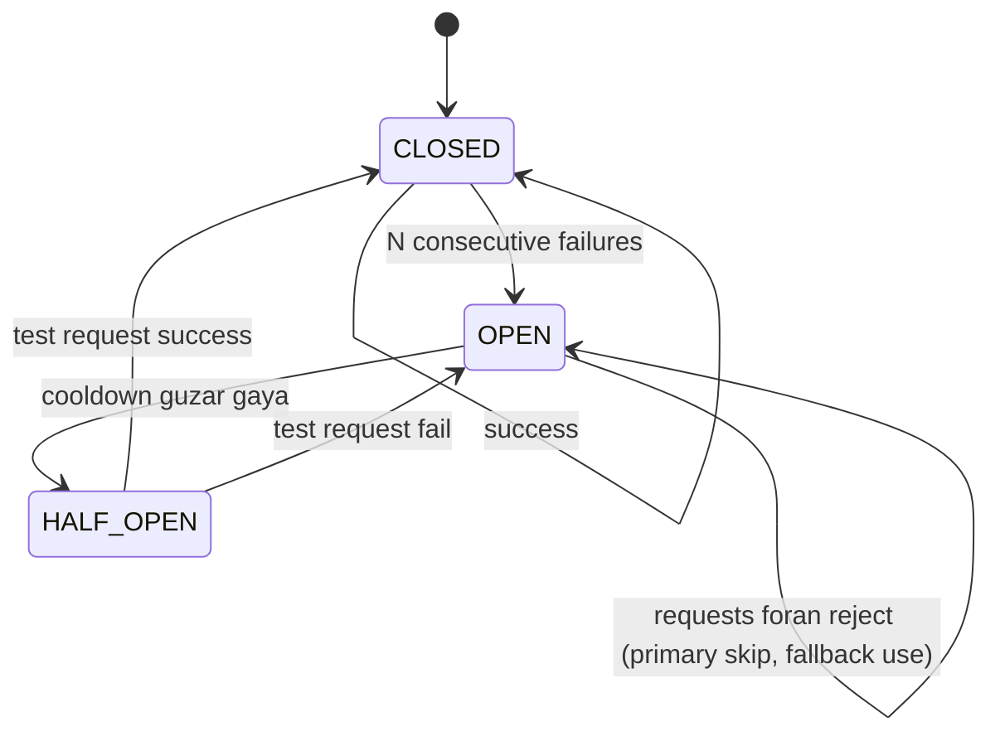
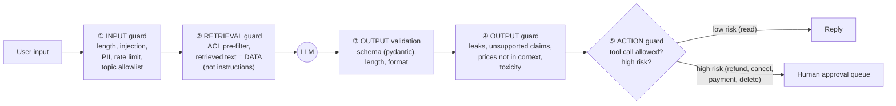
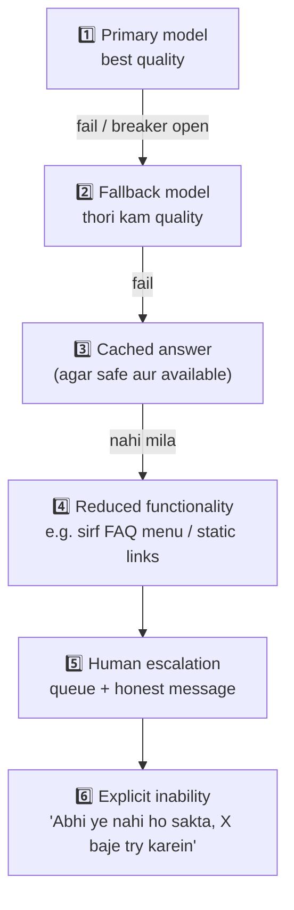

# M9.6 · Reliability, Guardrails & Graceful Degradation

> **Outcome:** Aisa system design karna jo **useful rahe** jab us ke individual AI components fail hon.

---

## 1. Simple samjhao

Ek acha restaurant tab bhi chalta hai jab:
- Main chef bimaar ho → doosra chef (fallback model)
- Gas khatam ho → cold items menu par (reduced functionality)
- Bohat rush ho → "20 minute wait" ka token (queue)
- Customer ajeeb order kare → manager se approval (human approval)

Kharab restaurant mein ek cheez fail hui to **poora band**. AI systems mein bhi yahi farq hai.

> 🔑 **Reliability ka matlab "kabhi fail na ho" nahi. Matlab: fail ho to kya hota hai, ye pehle se design kiya gaya ho.**

---

## 2. Failure catalog: kya kya fail hota hai?

| Failure | Misaal | Detect kaise | Response |
|---|---|---|---|
| **Provider outage** | Groq 503 for 30 min | 5xx, connection error | Circuit breaker → fallback provider |
| **Rate limit** | 429 Too Many Requests | 429 status, `Retry-After` header | Backoff retry, queue, fallback |
| **Timeout / hang** | Response 60s tak nahi aaya | Timeout | Timeout → retry/fallback |
| **Malformed output** | JSON ki jagah text, missing fields | Schema validation (pydantic) | Repair retry → fallback |
| **Wrong/hallucinated output** | Galat price, invented policy | Output guards, groundedness check, evals | Block → safe reply / human |
| **Retrieval failure** | Vector DB down, 0 results, irrelevant chunks | Exception, empty results, low scores | "Mujhe ye info nahi mili" + human, ya keyword fallback |
| **Tool failure** | Shopify API 500 | Exception | Retry, ya "order status abhi check nahi ho raha" |
| **Bad input** | 50k-char message, injection, spam loop | Input guards, rate limiter | Reject politely |
| **Cost runaway** | Agent infinite loop, retry storm | Budget meter, max steps | Hard caps |
| **Dependency drift** | Provider ne model update kiya, behavior badal gaya | Evals in CI, monitoring (M9.8) | Model version pin, alerts |

---

## 3. The resilience toolbox

### 3.1 Timeouts
- **Har** external call par timeout: LLM, vector DB, tools. **Default "forever wait" sab se khatarnaak bug hai.**
- **Total request budget** bhi rakho (e.g. 8s): retries + fallbacks sab is ke andar. Warna 3 retries × 30s = user 90s wait karega.
- LLM timeouts output length ke hisaab se: 200 tokens ke liye 15–20s kaafi, lambi reports ke liye zyada (ya async, M9.7).

### 3.2 Retries (sahi tareeqe se)

| Rule | Kyun |
|---|---|
| **Sirf retryable errors** (429, 5xx, timeout, connection) | 400/401 ko retry karna bekaar hai: same jawab aayega |
| **Exponential backoff + jitter** (0.5s, 1s, 2s... ± random) | Sab clients ek saath retry na karein (thundering herd) |
| **Max attempts** (2–3) + **total deadline** | Infinite retry = retry storm |
| **`Retry-After` header respect** | Provider bata raha hai kab aana hai |
| **Idempotency** for actions | "Order cancel" do dafa chal gaya? Idempotency key lagao |
| **Retry ek hi layer par** | SDK bhi retry kare, gateway bhi, app bhi = 3×3×3 = 27 calls! |

> ⚠️ Demo 8: retries ne 36 requests bachayin, lekin primary par calls bhi badhin. Outage mein sab ka retry karna provider ko aur dabata hai.
> Isi liye **retry + circuit breaker** saath chalte hain.

### 3.3 Circuit breaker



**Faida:** Provider down hai to har request ko 3 retries × timeout ka wait nahi karna parta. Breaker OPEN → seedha fallback (Demo 4: OPEN ke baad latency 0.15s → 0.08s, primary calls ruk gayin).
**Trade-off:** cooldown lamba = recovery slow (Demo 8: outage 0.6s, cooldown 1s → extra fallback traffic). Cooldown chhota = band provider ko baar baar hit.

### 3.4 Fallbacks (M9.3 recap)
Model/provider fallback. Lekin yaad rakho: **fallback = quality risk**. Fallback model bhi eval karo.

### 3.5 Queues
- **Spike absorb karna:** 1,000 messages ek minute mein → queue → workers apni speed se process karein (rate limit ke andar).
- **Async kaam:** lambi report, bulk jobs (M9.7).
- **Retry later:** provider down → message queue mein, baad mein process + user ko "jaldi jawab dete hain".
- Tools: Redis + RQ/arq/Celery, AWS SQS, RabbitMQ.

### 3.6 Rate limits (apni taraf se)
- **Per user** (token bucket, Demo 7): spam, bot loops (do bots aapas mein baat karte rahein!), abuse.
- **Per tenant** budget (M9.3).
- **Global concurrency** (bulkhead / semaphore): ek feature ki slowness poora system na giraye.

---

## 4. Guardrails at system boundaries

Model par akela bharosa mat karo. **Har boundary par check** lagao:



| Boundary | Kya check | Tools |
|---|---|---|
| ① Input | Length, injection patterns, PII masking (logs ke liye), allowed topics | Regex, Llama Guard / classifier, Presidio (PII) |
| ② Retrieval | ACL **pre-filter**, retrieved docs ko "data" treat karo | Metadata filters (M9.2), delimiters |
| ③ Output validation | Schema, types, enums, length | **Pydantic**, JSON mode / structured outputs |
| ④ Output guard | Internal data leak, invented prices/policies, unsafe content, promises | Regex + groundedness check + moderation model |
| ⑤ Action | Kaun sa tool, kitna risk, kis ki permission | Allowlist, risk tiers, **human approval** |

> 🔑 **Deterministic checks pehle (sastay, reliable), LLM-based checks baad mein (mehnge, flexible).**
> Level 8 (security) ki techniques yahan **architecture ki boundaries** par lagti hain.

---

## 5. Graceful degradation ladder



**Rules:**
- User ko **sach batao**. "System busy hai, team rabta karegi" >>> galat jawab ya chup.
- Har level ko **log** karo (`level=fallback`), taake pata chale kitna traffic degraded tha.
- Kuch features degrade nahi hone chahiye. Woh **fail closed** hon. Jaise refund approval: model na ho to approval bhi nahi.

| Fail **open** (chalta rahe) | Fail **closed** (ruk jaye) |
|---|---|
| FAQ answers (cache/canned se) | Payments, refunds, account changes |
| Product info | Medical / legal advice |
| Small talk | Kuch bhi irreversible |

---

## 6. Human approval for high-risk actions

**Human-in-the-loop (HITL) patterns:**

| Pattern | Kaise | Kab |
|---|---|---|
| **Approve before execute** | AI draft banaye → human approve/edit/reject → phir action | Refund, cancel, bulk emails, payments |
| **Review after (sampling)** | Action ho jaye, human sample check kare | Low risk, high volume |
| **Escalation** | AI pehchane "ye mere bas ka nahi" → human ko de | Complaints, angry customers, unknown |
| **Threshold** | Rs 5,000 se upar refund → approval; neeche auto | Risk ka size |

Demo 6: refund request → model ka draft **user ko nahi gaya**. Approval queue mein gaya, aur user ko honest status mila.

**Risk tiers for tools** (agents/M9.7 ke liye zaroori):
```
Tier 0  read-only          get_order_status, search_faq          → auto
Tier 1  reversible write   add_note, tag_conversation            → auto + log
Tier 2  customer-impacting send_email, apply_discount            → approval / limits
Tier 3  irreversible/money refund, cancel_order, delete          → ALWAYS human approval
```

---

## 7. Service-level expectations (SLIs / SLOs)

| Term | Matlab |
|---|---|
| **SLI** (indicator) | Kya naap rahe ho: % successful requests, p95 latency |
| **SLO** (objective) | Target: 99.5% availability monthly, p95 < 4s |
| **SLA** (agreement) | Client se **contract** wala promise (penalties ke saath). SLO se loose rakho |
| **Error budget** | 99.5% → 0.5% = ~3.6 ghante/mahina "fail" allowed. Budget khatam → naye features ki jagah reliability par kaam |

**AI systems ke liye 3 qisam ke SLOs:**

| Type | Example SLO | Kaise naapein |
|---|---|---|
| **Availability** | 99.5% requests ko useful jawab (any level) | Levels count (Demo 8) |
| **Latency** | p95 < 4s, p99 < 8s | Tracing |
| **Quality** | Eval score ≥ 85%, thumbs-down < 5%, wrong-policy < 2% | Online evals + feedback (M9.8) |
| (Degradation) | ≥ 90% traffic primary par | `level` metric |

> ⚠️ AI ki khaas baat: system **up** ho sakta hai lekin **galat** jawab de raha ho. Is liye quality SLO alag se chahiye.

---

## 8. Code walkthrough: `reliability.py`

| Demo | Concept |
|---|---|
| 1 | 429 → tenacity exponential backoff + jitter → success |
| 2 | Retryable vs non-retryable classification |
| 3 | Hang → `asyncio.wait_for` timeout → fallback |
| 4 | Outage → circuit breaker CLOSED → OPEN (fast fail) → HALF_OPEN → CLOSED |
| 5 | Bad JSON → pydantic `ValidationError` → repair prompt → success |
| 6 | Input injection block, output leak block, refund → approval queue |
| 7 | Token bucket rate limiter |
| 8 | Chaos load test → availability / primary % / p95 → **SLO report** |

---

## 9. Industry mein kya hota hai

- **Chaos engineering:** Netflix jaisi companies production mein jaan boojh kar failures daalti hain. Is script ka `Chaos` class usi ka chhota version hai.
- **Multi-provider:** critical AI products 2+ providers rakhte hain aur failover automatic hota hai.
- **Guardrail frameworks:** NeMo Guardrails, Guardrails AI, Llama Guard, cloud moderation APIs. Lekin core checks aksar simple deterministic code hote hain.
- **Approval workflows:** Slack/WhatsApp group mein "Approve / Reject" buttons, aur AI sirf draft karta hai.
- **Status pages + incident runbooks:** "Groq down → kya karna hai" likha hota hai.
- **Idempotency keys** har write action par (payment APIs ki tarah).

---

## 10. Common mistakes

| Mistake | Fix |
|---|---|
| Timeout nahi | Har call + total budget |
| Har error retry | Sirf 429/5xx/timeout |
| Retries har layer par | Ek layer (gateway) par |
| Fixed backoff, no jitter | Exponential + jitter |
| Model output seedha `json.loads` aur use | Pydantic schema + repair |
| Guardrail sirf system prompt mein | Code boundaries par checks |
| Refund tool model ke haath mein, bina approval | Risk tiers + human approval |
| Fail hone par user ko chup | Honest degraded message + human queue |
| Sirf uptime naapna | Quality SLO bhi |
| Write action retry → double refund | Idempotency key |

---

## 11. Freelance lens 💼

- **Proposal mein "What happens when..." section** likho: Groq down, Shopify down, bot ko jawab na aaye, customer gussa ho. Ye aap ko 90% freelancers se alag karta hai.
- **Client ka WhatsApp group = human approval channel.** Refund/cancel requests wahan "Approve?" message ke saath jayein. Client ko lagega control uske haath mein hai, aur yahi sach bhi hai.
- **SLA mat do jo aap ke bas mein nahi.** Groq ki uptime aap control nahi karte. Likho: "best-effort 99% with automatic fallback", aur SLA ki jagah SLO internal rakho.
- **Monitoring alert** (M9.8) apne phone par lagao: fallback traffic > 20% ya error rate > 5% → WhatsApp/Telegram alert. Client ke complain karne se **pehle** aap ko pata ho.
- **Cost runaway** se bachao: max steps, max tokens, per-user rate limit. Ek bot loop raat bhar chala to client ka bill aap ki fee se zyada ho sakta hai.

---

## 12. Interview questions + model answers

**Q1. LLM provider 30 minute ke liye down hai. Aapka system kya karega?**
> Har call par timeout hai, aur retryable errors par backoff ke saath limited retries. Lagatar failures par circuit breaker open hota hai, taake baqi requests wait kiye bina fallback provider par jayein. Ideally same model doosre provider par, warna evaluated fallback model. Agar fallback bhi fail ho to safe cached answers, phir reduced functionality, phir human queue ke saath honest message. High-risk flows fail closed hote hain. Har request ka degradation level log hota hai aur alerts trigger hote hain. Cooldown ke baad half-open probe se primary par wapas.

**Q2. Retries ke risks kya hain?**
> Retry storms aur thundering herd, kyunke outage mein sab clients retry karte hain aur provider aur dab jata hai. Multiple layers retry karein to amplification. Write actions duplicate ho sakte hain. Mitigation: sirf retryable errors, exponential backoff with jitter, max attempts plus total deadline, Retry-After respect, ek hi layer par retry, circuit breaker, aur writes par idempotency keys.

**Q3. Guardrails kahan lagaoge?**
> System boundaries par, sirf model ke andar nahi. Input par length, injection aur rate limits. Retrieval par ACL pre-filter, aur retrieved text ko data treat karna. Output par schema validation aur content guards (leaks, unsupported claims, prices not in context). Actions par tool allowlist, risk tiers, aur high-risk ke liye human approval. Pehle deterministic checks, phir model-based classifiers.

**Q4. AI system ke liye SLOs kaise define karoge?**
> Teen dimensions: availability (useful response rate, degraded levels samet), latency (p95/p99), aur quality (online eval score, thumbs-down rate, specific failure rates jaise wrong-policy). Plus degradation SLO: kitna traffic primary par hai. Error budget se decide hota hai kab features ki jagah reliability par kaam karna hai. Client SLA in se loose rakhta hoon, kyunke third-party providers meri control mein nahi.

---

## 13. Hands-on

```powershell
pip install tenacity pydantic
python 06_reliability_guardrails\reliability.py          # mock (offline)
python 06_reliability_guardrails\reliability.py --real   # Groq primary + chaos
```

## 14. Summary

- Har failure ke liye **pehle se response** design karo (failure catalog).
- **Timeouts har jagah** + total budget. **Retries** sirf retryable errors par, backoff + jitter, ek layer par.
- **Circuit breaker** outage mein fast-fail aur provider ko saans deta hai.
- **Guardrails boundaries par**: input → retrieval → output validation → output guard → action.
- **Degradation ladder**: primary → fallback → cache → reduced → human → honest inability.
- High-risk actions: **human approval**, fail closed, idempotency.
- SLOs: **availability + latency + quality**.

**Next: M9.7 AI pipeline orchestration.**
