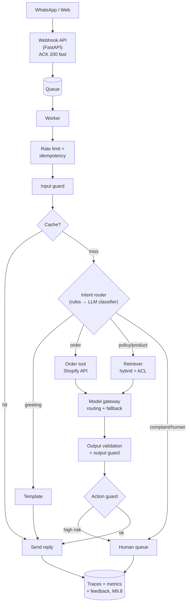
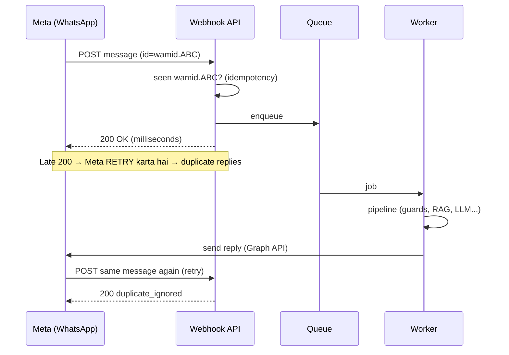
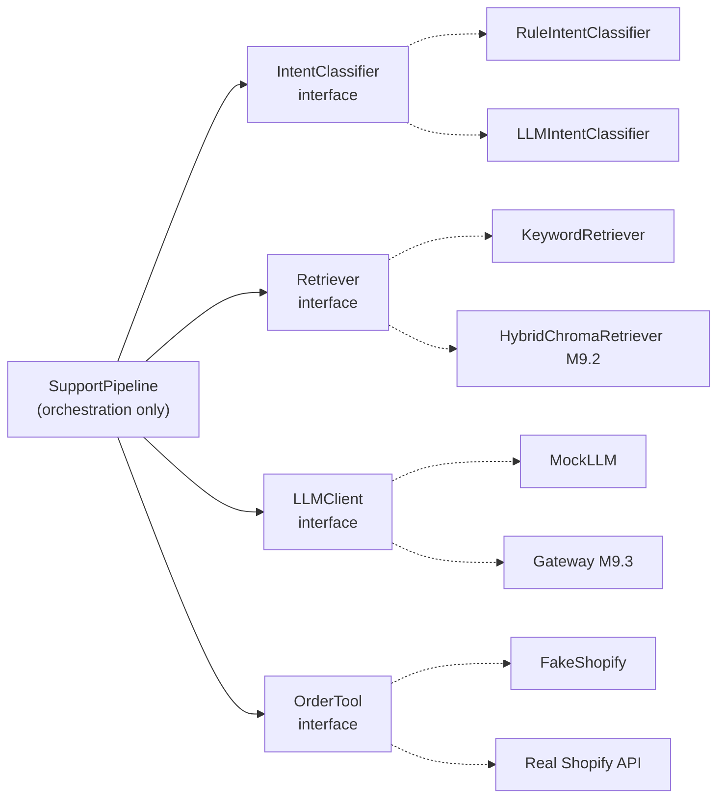

# M9.7 · AI Pipeline Orchestration

> **Outcome:** Individual AI components (retrieval, models, tools, guards, caches) ko ek
> **coherent production system** mein jodna.

---

## 1. Simple samjhao

Pichle modules mein aap ne **parts** banaye: knowledge layer (M2), gateway (M3), cache (M5), guards (M6).
Orchestration ye decide karta hai:
- Kaun sa part **kab** chalega, aur kis **order** mein?
- Kaun sa faisla **code** karega aur kaun sa **model**?
- User **wait** karega, ya kaam **background** mein hoga?
- Parts ke beech **boundaries** kahan hain, taake har part alag se badla ja sake?

---

## 2. End-to-end flow: poora system ek nazar mein



Yahi diagram aapke **capstone** (M9.10) ka base banega.

---

## 3. Deterministic vs model-delegated decisions

> 🔑 **Default: code decide kare. Model sirf wahan jahan language samajhni ya likhni ho, ya input itna open-ended ho ke rules na ban sakein.**

| Decision | Kaun kare | Kyun |
|---|---|---|
| Order number nikaalna (`#12345`) | **Code** (regex) | Exact, free, 100% reliable |
| Order ka status | **Code** (API call) | Fact hai, model guess na kare |
| Refund allowed? (7 din, unused) | **Code** (business rules) | Policy enforcement model ke haath mein **kabhi nahi** |
| Kaun sa tool call ho, jab flow fixed hai | **Code** | Predictable, testable |
| Intent (common cases) | **Code** (rules) | Sasta, tez |
| Intent (ajeeb/naye phrasing) | **Model** (classifier) | Rules cover nahi kar sakte |
| Customer ki baat samajhna (Roman Urdu, typos) | **Model** | Language understanding |
| Jawab ki wording, tone, language | **Model** | Natural language generation |
| Open-ended research ("in 10 sources ko compare karo") | **Model** (agent) | Steps pehle se pata nahi |
| Kab human ko dena hai | **Dono** | Rules (keywords, high-risk) + model (sentiment/confusion) |

**Test:** "Kya main is faisle ka unit test likh sakta hoon?" Agar haan, to usse code mein rakho.

---

## 4. Workflows vs agents: complexity ki seedhi

Anthropic ki "Building effective agents" guide ka framework (industry standard ban chuka hai):

| Pattern | Kya hai | Example |
|---|---|---|
| **Single call** | Ek prompt | Classification, extraction |
| **Prompt chaining** | Fixed steps, ek ka output agle ka input | Draft → translate → format |
| **Routing** | Input classify → specialized path | Support bot (ye module!) |
| **Parallelization** | Independent subtasks saath; ya same task multiple dafa (voting) | Guardrail check + answer parallel |
| **Orchestrator-workers** | Ek LLM kaam baante, workers karein, results jode | Multi-file code change |
| **Evaluator-optimizer** | Generate → critique → improve loop | Translation, writing quality |
| **Autonomous agent** | LLM khud decide kare next step, tools, kab rukna hai | Deep research, coding agent |

```
Predictability  ▲  Single call → Chain → Routing → Parallel → Orchestrator → Agent  ▼
Flexibility     ▼                                                                    ▲
Cost/latency    ▼ kam                                                         zyada  ▲
```

### Kab agent NAHI banana
- Steps pehle se pata hain (support bot: classify → fetch → answer)
- Latency tight hai (WhatsApp, voice)
- Galti ki qeemat zyada hai aur har step audit hona chahiye
- Aap akele maintain karoge aur debug karna hai

### Kab agent sahi hai
- Steps input par depend karte hain aur pehle se nahi likhe ja sakte
- Task lamba aur exploratory hai (research, coding)
- User wait kar sakta hai, aur cost justified hai

> ⚠️ "LangGraph agent banao" se shuru karna Level 9 ki sab se common galti hai.
> Isi module ka `SupportPipeline` **bina agent ke** greeting, order, FAQ, unknown aur human handoff sab handle karta hai,
> aur 6 mein se 3 cases mein LLM call hi nahi hui.

---

## 5. Sync, async, queued, long-running

| Pattern | Kab | Example | Implementation |
|---|---|---|---|
| **Synchronous** | Jawab seconds mein, user wait kar raha hai | Web chat `/chat` | Normal HTTP request |
| **ACK + async** | Caller ko foran 200 chahiye, kaam baad mein | **WhatsApp webhook** | Return 200 → background/queue |
| **Queued job** | Spikes absorb karne hain, rate limits ke andar | 1,000 messages ek saath | Redis + arq/RQ/Celery, SQS |
| **Long-running job** | 30s–30 min | Weekly report, bulk classify | `202 Accepted` + `job_id` + polling/webhook/WhatsApp notify |
| **Durable workflow** | Ghanton/dinon ka, multi-step, crash ke baad resume | Approval wait, research agent | Temporal, AWS Step Functions, LangGraph + checkpointer |
| **Scheduled / batch** | Fixed time par | Nightly re-index (M9.2), Batch API | Cron, scheduler |

### WhatsApp webhook pattern (zaroor samjho)



`try_app.py` scenario 2 yahi dikhata hai: same `message_id` dobara aaya, reply sirf **ek** gaya.

---

## 6. Component boundaries



**Clear boundaries ke faide:**
1. **Alag se evaluate:** retriever ka recall alag, classifier ki accuracy alag, generation ki quality alag. Masla kahan hai, turant pata chalta hai.
2. **Alag se replace:** Chroma → pgvector, Groq → OpenAI, bina pipeline badle.
3. **Alag se scale:** ingestion worker, API server, LLM workers alag processes.
4. **Testing:** mock implementations se poora flow offline test (`try_app.py`).

**Boundary rules:**
- Har component ka **input/output contract** typed ho (pydantic / dataclass).
- Component ke andar ki cheez (prompts, DB) bahar leak na ho.
- **Composition root** (`app.py` ki `pipeline = SupportPipeline(...)` line) ek hi jagah implementations jodta hai.
- Har step ka trace (`steps`) ho, taake waterfall aur debug ho sake (M9.4, M9.8).

---

## 7. Industry mein kya hota hai

- **Webhook → queue → worker** har messaging integration ka standard hai.
- **Workflow engines** (Temporal, Step Functions, Inngest) lambe, approval wale, crash-safe processes ke liye.
- **LangGraph** jab state machine + checkpoints + human-in-the-loop chahiye. Lekin bohat si teams simple Python functions se shuru karti hain.
- **Hexagonal / ports-and-adapters architecture:** business logic beech mein, providers "adapters" ke taur par. Yahi interfaces wala idea hai.
- **Feature flags** naye components (LLM classifier, reranker) ko gradual on karne ke liye.

---

## 8. Common mistakes

| Mistake | Fix |
|---|---|
| Har cheez agent se | Pehle deterministic pipeline |
| Business rules (refund eligibility) prompt mein | Code mein |
| Webhook handler mein poora LLM kaam | ACK fast, queue/background |
| Idempotency nahi | Message ID dedupe |
| 2 min ka kaam sync HTTP mein | Job + polling |
| Pipeline mein provider SDK seedha | Interfaces + composition root |
| Kisi step ka trace nahi | Har step timed + logged |
| Background task process crash mein kho gaya | Real queue (persistent) production mein |

---

## 9. Freelance lens 💼

- **Client ko flow diagram dikhao** (section 2 jaisa). Non-technical client bhi samajh jata hai, aur aap ka professionalism dikhta hai.
- **Deterministic pipeline = kam bugs = kam support calls.** Aap akele 5–10 clients tabhi sambhal sakte ho jab har bot predictable ho.
- **Interfaces = reusable product.** `Retriever`, `LLMClient`, `OrderTool` interfaces ke saath agla client (doosri Shopify dukan) mein aap sirf **adapters aur data** badlo. Core pipeline same. Ye aap ka **template product** ban jata hai, aur har naya project tez aur sasta hota hai.
- Shopify ke ilawa WooCommerce/Daraz client aaye? Bas naya `OrderTool` adapter likho.

---

## 10. Interview questions + model answers

**Q1. Aap ka support bot agent hona chahiye ya workflow?**
> Workflow. Steps predictable hain: classify, phir order tool / RAG / human, phir generate, phir guards. Deterministic routing sasti, tez, testable aur auditable hai. Model sirf language understanding (ajeeb intents) aur generation ke liye. Agent tab consider karunga jab tasks open-ended hon aur steps input par depend karein, aur woh bhi tool risk tiers aur step/cost limits ke saath.

**Q2. Kaun se decisions model ko doge aur kaun se code ko?**
> Jo exact, rule-based, ya policy enforcement hai (IDs nikaalna, eligibility, permissions, tool selection jab flow fixed ho) woh code. Jo language understanding/generation hai ya itna open-ended ke rules na ban sakein, woh model. Agar kisi faisle ka unit test likh sakta hoon, to woh code mein hona chahiye.

**Q3. WhatsApp webhook ko kaise design karoge?**
> Handler foran verify karta hai, message ID ke saath idempotency check karta hai, kaam queue mein daalta hai, aur 200 return karta hai. Worker pipeline chalata hai aur Graph API se reply bhejta hai. Late response par Meta retry karta hai, to idempotency ke bina duplicate replies jaate hain. Queue spikes absorb karti hai aur rate limits ke andar processing hoti hai.

**Q4. Component boundaries kyun zaroori hain?**
> Taake har part ko independently evaluate, replace aur scale kiya ja sake. Retriever ka recall, classifier ki accuracy aur generator ki faithfulness alag naapi jaati hain, to regression ka source turant pata chalta hai. Typed contracts aur ek composition root ke saath providers ya vector stores badalna local change ban jata hai, aur mock implementations se poora flow offline test hota hai.

---

## 11. Hands-on

```powershell
pip install fastapi uvicorn httpx
python 07_pipeline_orchestration\try_app.py                       # saare scenarios
uvicorn app:app --app-dir 07_pipeline_orchestration --reload      # server
# browser: http://127.0.0.1:8000/docs
```
`.env` mein `GROQ_API_KEY` ho to real Groq lagega. Force mock ke liye PowerShell mein: `$env:LLM_MODE="mock"`

## 12. Summary

- Orchestration = parts ko **sahi order, sahi execution mode, sahi boundaries** ke saath jodna.
- **Code decide kare, model sirf language ke liye.** Unit-test wala test yaad rakho.
- Workflow patterns (chain, routing, parallel, orchestrator, evaluator) → agent **aakhri** option.
- Execution: sync / ACK+async / queue / job / durable workflow / batch. **Webhook = ACK fast + idempotency.**
- **Interfaces + composition root**: har component independently test, replace, scale.

**Next: M9.8 Monitoring, feedback & continuous improvement.**
