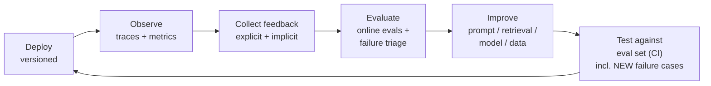
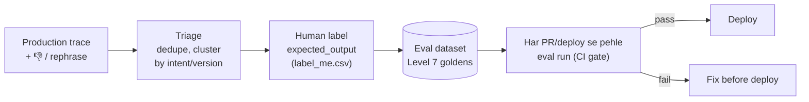

# M9.8 · Monitoring, Feedback & Continuous Improvement

> **Outcome:** Aise AI products design karna jo **real-world usage se behtar** hote rahein,
> launch ke baad static na rahein.

---

## 1. Simple samjhao

Normal software mein bug ho to crash hota hai, error aata hai, pata chal jata hai.
AI mein bug **khamosh** hota hai: system chal raha hai, 200 OK aa raha hai, lekin jawab **galat** hai.
Customer complain bhi nahi karta, bas chala jata hai.

Is liye AI systems mein monitoring sirf "server up hai?" nahi, balki **"jawab ache hain?"** bhi hai.
Aur har galti ko **eval case** bana kar system ko us galti se **hamesha ke liye** bachana hai.

---

## 2. The loop



Level 7 mein aap ne **offline evals** banaye. Yahan woh **production loop** ka hissa bante hain:
production failures → eval set mein → har naye deploy se pehle test.

---

## 3. Kya monitor karna hai?

| Category | Metrics | Kyun |
|---|---|---|
| **Quality** | Thumbs-down rate, implicit bad signals, online eval scores (faithfulness, relevance), escalation rate | AI ka asal failure mode |
| **Latency** | p50/p95/p99 total + **per span** (retrieval, TTFT, generation, tools) | M9.4 |
| **Cost** | $/request, $/tenant, $/feature, tokens in/out, reasoning tokens | Budget, margin |
| **Errors** | Provider errors (429/5xx), timeouts, validation failures, guard blocks | M9.6 |
| **Retrieval** | Top-k scores, empty-result rate, kaun se docs kitni dafa aaye, "no-answer" rate | Knowledge gaps dikhata hai |
| **Tool usage** | Kaun sa tool, kitni dafa, failure rate, latency | Agents/tools ka health |
| **Model/provider** | `served_by` distribution, fallback %, per-model quality | M9.3 |
| **Cache** | Hit rate per layer, wrong-hit rate | M9.5 |
| **Degradation** | % traffic per level (primary/fallback/canned/human) | M9.6 |
| **Business** | Resolution rate, human-handoff rate, conversions, CSAT | Client ko yahi chahiye |

### Ek trace record mein kya hona chahiye? (`tracer.py`)

```
trace_id, timestamp, tenant, user_hash (PII nahi!), session_id
input, output, intent, route, level (primary/fallback/...)
app_version, prompt_version, model, served_by, retrieval_config, kb_version   ← VERSIONS
latency_ms, ttft_ms, tokens_in, tokens_out, cost_usd
cache_hit, retrieved_ids, tool_calls, error
+ feedback (baad mein, trace_id se linked)
```

> 🔑 **Versions sab se important columns hain.** Inke bina "kal se quality kyun giri?" ka jawab namumkin hai.

---

## 4. Feedback: explicit vs implicit

| Type | Examples | Pros | Cons |
|---|---|---|---|
| **Explicit** | 👍/👎, rating 1–5, "ye galat hai" + comment, correction | Clear signal | **Kam** (~1–15% users dete hain), naraz log zyada dete hain (bias) |
| **Implicit** | User ne sawal **dobara** pucha (rephrase), "agent se baat karao", conversation chhor di, copy kiya, order place kiya, "shukriya" | **Bohat zyada** data, har interaction se | **Noisy**: chhor dena = satisfied bhi ho sakta hai |

`monitoring_lab.py` ka dashboard dekho: explicit 👎rate roz **0% se 57%** tak uchhalta hai (roz sirf ~9 thumbs), jab ke implicit signals stable trend dete hain. **Dono saath use karo.**

### WhatsApp par feedback kaise lein?
- Jawab ke baad **interactive buttons**: "✅ Madad hui" / "❌ Nahi hui" (sirf kabhi kabhi, har message par nahi, warna irritating)
- Reactions (👍❤️😡) bhi webhook mein aate hain
- Implicit: 2 minute ke andar same topic dobara → rephrase signal; "agent", "insaan" → escalation signal

### Privacy
- Phone numbers / names **hash** karo (`hash_user`), raw PII logs mein mat rakho
- Retention policy: e.g. 90 din baad raw text delete, sirf metrics rakho
- Client ko batao kya log ho raha hai (Level 8: data protection)

---

## 5. Failures become evaluation cases



`monitoring_lab.py` step 6 exactly yahi karta hai: negative-feedback traces → dedupe → `eval_candidates.json` (DeepEval-style: `input, actual_output, expected_output, context, additional_metadata`) + `label_me.csv` (Excel mein `expected_output` bharo).

**Faida:** jo galti ek dafa hui, woh **dobara kabhi production mein nahi jayegi**, kyunke eval set usse pakad lega. Waqt ke saath aap ka eval set **real user behavior** ka reflection ban jata hai.

---

## 6. Versioning for traceable regressions

Har cheez jo output badal sakti hai, uska version:

| Kya | Kaise version karein |
|---|---|
| **App code** | Git tag / commit SHA (`v1.5`) |
| **Prompts** | Prompt files git mein (`prompts/support-v4.txt`) ya prompt registry (Langfuse Prompts) |
| **Model** | Exact model ID (`openai/gpt-oss-20b`), provider ke silent updates ke liye date note |
| **Retrieval config** | `hybrid-k3-rerank`: chunk size, k, reranker, embedding model |
| **Knowledge base** | `kb_version` (M9.2, M9.5) |
| **Guardrail rules** | Version / git |

Har trace mein ye sab → regression aaye to **kaun si change** ki wajah se, query se pata chal jata hai.

### Lab ki kahani (step 3b)
```
intent           v1.4    v1.5   change
faq_delivery       2%     36%   +34%  ⚠️ REGRESSION
unknown           27%     19%   -9%   ✅ better
```
Overall bad-rate 9% → 15% hua. Lekin **intent ke hisaab se todne** par pata chala ke sirf delivery sawal bigde (prompt `support-v4` ka "max 25 words" city-wise info kaat raha tha), jab ke reranker ne `unknown` ko behtar kiya.
**Faisla:** sirf prompt rollback, reranker rakho. Versioning ke bina ye "sab rollback karo" hota, aur reranker ka faida bhi chala jata.

> 🔑 **Average mein masle chhup jaate hain. Hamesha slice karo:** by intent, version, tenant, language, level, model.

---

## 7. Deployment safety (Level 10 mein detail)

| Technique | Kya |
|---|---|
| **Offline eval gate** | CI mein eval set pass karo, tab deploy |
| **Shadow mode** | Naya version chalao, jawab log karo, user ko purana dikhao. Compare karo |
| **Canary / gradual rollout** | 5% traffic naye version par → metrics theek → 50% → 100% |
| **A/B test** | Do versions, random users, business metric compare |
| **Feature flags** | Instant off switch |
| **Fast rollback** | Config/version change, redeploy nahi |

---

## 8. Alerts

`monitoring_lab.py` step 4 ke rules:
```
bad-rate  > 1.5× 7-day baseline        → 🚨 day 8, 9, 12 (regression)
fallback  > 10%                         → 🚨 day 11 (outage)
p95       > SLO (4000 ms)
cost/req  > +30% vs baseline
```
- Alerts **actionable** hon. Har alert ke saath "kya karna hai" (runbook).
- Bohat zyada alerts = log ignore karne lagte hain (alert fatigue). Sirf important rakho.
- Freelancer ke liye: Telegram/WhatsApp/email par alert.

---

## 9. Tools (industry)

| Tool | Type | Notes |
|---|---|---|
| **Langfuse** | Open-source LLM observability (cloud free tier + self-host) | Traces, scores, prompts, datasets, evals. `langfuse_tracing.py` |
| LangSmith | LangChain ka managed platform | LangChain/LangGraph users mein popular |
| Arize Phoenix | Open-source, OpenTelemetry based | Evals + tracing |
| Helicone | Proxy-based logging | Gateway ki tarah lagta hai |
| OpenTelemetry + Grafana/Datadog | General observability | Bari companies, infra metrics ke saath |
| DeepEval / RAGAS (Level 7) | Eval libraries | Online + offline evals |

**Freelance default:** Langfuse (free, self-host option, sab kuch ek jagah).

---

## 10. Common mistakes

| Mistake | Fix |
|---|---|
| Sirf uptime/errors monitor | Quality metrics + feedback |
| Versions log nahi | app/prompt/model/retrieval/kb version har trace mein |
| Sirf averages | Slice by intent/version/tenant/level |
| Sirf explicit feedback par bharosa | Implicit signals bhi |
| Raw phone numbers logs mein | Hash + retention policy |
| Failures dekhe, eval set mein nahi daale | Failure → labeled eval case → CI gate |
| Prompt production mein seedha edit | Version + eval + rollout |
| Har cheez par alert | Actionable alerts + runbooks |

---

## 11. Freelance lens 💼

- **Monthly client report** (5 minute ka kaam, bohat value): conversations, auto-resolve %, top 10 sawal, unanswered sawal, cost, uptime. Ye report **retainer contract** (monthly maintenance fee) ka justification hai.
- **"Unanswered questions" list** client ko bhejo: "Customers ye pooch rahe hain jo FAQ mein nahi." Client FAQ update karta hai, aur bot behtar hota hai. Client ko lagta hai bot **seekh** raha hai.
- **Retainer pitch:** "Main har mahine failures review karta hoon, eval set update karta hoon, aur bot ko improve karta hoon." Ye recurring income hai, aur ek one-time project ko long-term client bana deta hai.
- Alert apne phone par: client ke complain karne se **pehle** aap ko pata ho.

---

## 12. Interview questions + model answers

**Q1. Production mein LLM app ko kaise monitor karoge?**
> Har request ka trace: input, output, route, degradation level, aur saare versions (app, prompt, model, retrieval config, KB), plus per-span latency, tokens aur cost, cache hit, retrieved IDs, tool calls. Metrics: quality (explicit + implicit feedback, sampled online evals), latency p95 per span, cost per request/tenant, errors, fallback %, retrieval empty-rate. Dashboards ko slices (intent, version, tenant, language) ke saath dekhta hoon, aur actionable alerts baseline ke against lagata hoon.

**Q2. Explicit aur implicit feedback mein kya farq hai?**
> Explicit (thumbs, ratings, corrections) clear hai lekin sparse aur biased, kyunke naraz users zyada dete hain. Implicit (rephrase, human handoff request, abandonment, task completion) har interaction se milta hai lekin noisy hai. Dono combine karta hoon: implicit trends aur alerts ke liye, explicit aur human review labels ke liye.

**Q3. Production failures ko improvement mein kaise convert karoge?**
> Negative signals wale traces collect karke dedupe aur cluster karta hoon (intent/version), aur human se expected output label karwata hoon. Phir unhe eval dataset mein add karta hoon. Har prompt/model/retrieval change CI mein is set ke against run hota hai. Is tarah ek dafa ki galti regression test ban jaati hai, aur eval set real traffic ko represent karta hai.

**Q4. Deploy ke baad quality giri. Kaise pata karoge kyun?**
> Traces mein versions hain, to pehle before/after compare karta hoon aur phir slice karta hoon by intent, language, tenant, level. Isse pata chalta hai regression kahan concentrated hai. Phir us slice ke failing examples dekhta hoon aur jo component badla tha (prompt, retrieval config, model) uska asar isolate karta hoon. Sirf us component ko rollback karta hoon, aur failing cases eval set mein daal kar fix test karta hoon.

---

## 13. Hands-on

```powershell
python 08_monitoring_feedback\monitoring_lab.py        # offline: simulate + analyze + export
# output: 08_monitoring_feedback\output\eval_candidates.json, label_me.csv, traces.db

pip install langfuse
python 08_monitoring_feedback\langfuse_tracing.py      # real Langfuse (keys .env mein)
```
`traces.db` ko **DB Browser for SQLite** (free, Windows) se khol kar khud SQL queries chalao.

## 14. Summary

- AI bugs **khamosh** hote hain, is liye quality monitoring zaroori hai.
- Loop: **deploy → observe → feedback → evaluate → improve → test → redeploy**.
- Monitor: quality, latency (per span), cost, errors, retrieval, tools, provider, cache, degradation, business.
- Feedback: **explicit (kam, clear) + implicit (zyada, noisy)**.
- **Failures → labeled eval cases → CI gate.**
- **Version everything.** Har trace mein versions. Slice karo, average par bharosa mat karo.

**Next: M9.9 Case studies.** Ab tak ka sab kuch 3 real systems par apply karna.
