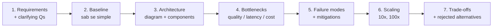

# M9.9 · Case Studies: Whiteboard karne ka tareeqa

> **Outcome:** Architectural decisions ko **defend** karna, sirf boxes aur arrows draw karna nahi.

Is folder mein 3 complete designs hain. Har ek **same structure** follow karta hai, jo aap interview aur client dono mein use karoge:

| File | System | Khaas sabaq |
|---|---|---|
| `01_customer_support_copilot.md` | Support copilot / bot | RAG + fresh knowledge, citations, routing, caching, human escalation, latency/cost |
| `02_coding_assistant.md` | Coding assistant | Bara codebase context, retrieval vs agentic search, sandboxed execution, long tasks |
| `03_deep_research_agent.md` | Deep research agent | Planning, parallel tools, context management, citations, cost budgets, failure recovery |

---

## 1. Har case ka structure (7 steps)

Ye M9.1 ke framework ka **interview version** hai.

---

## 2. 45-minute interview ka time plan

| Minute | Kya karna | Galti jo log karte hain |
|---|---|---|
| 0–5 | **Clarifying questions.** Users, scale, latency, quality bar, data, risk, budget | Seedha diagram banana shuru |
| 5–8 | **Back-of-envelope.** QPS, tokens, cost/month, latency budget | Numbers skip karna |
| 8–12 | **Baseline.** "Sab se simple version ye hoga..." | Pehli line mein multi-agent |
| 12–25 | **High-level architecture.** Diagram, data flow, har box ka kaam | Boxes bina explanation |
| 25–35 | **Deep dive** (interviewer jo poochhe): retrieval, routing, eval, safety | Sab kuch shallow |
| 35–42 | **Failure modes, scaling, monitoring** | Happy path hi batana |
| 42–45 | **Trade-offs summary + what I'd do next** | Bina conclusion ke khatam |

> 🔑 **Interviewer "sahi architecture" nahi dhoondh raha.** Woh dekh raha hai ke aap:
> (1) sahi sawal poochte ho, (2) numbers se sochte ho, (3) simple se shuru karte ho,
> (4) trade-offs khud bolte ho, (5) failures ke baare mein sochte ho.

---

## 3. Clarifying questions: universal list

Har AI system design mein ye poochho (sab nahi, 5–7 relevant):

1. **Users:** kaun? internal/external? kitne? kis channel par?
2. **Core tasks:** top 3 use cases kya hain? Kya system **actions** bhi lega ya sirf jawab dega?
3. **Scale:** requests/day, peak, growth?
4. **Latency:** interactive (seconds) ya background (minutes)? Streaming possible?
5. **Quality bar:** galti ki qeemat? citations chahiye? kya "pata nahi" kehna acceptable hai?
6. **Data:** kahan hai, kitna, kitni baar badalta hai, access control?
7. **Privacy/compliance:** PII? data residency? kaun sa provider allowed?
8. **Budget:** per request / per month?
9. **Existing systems:** CRM, ticketing, auth? Kya integrate karna hai?

Agar interviewer kahe "aap assume karo", to **assumptions bol kar likho** ("Main assume kar raha hoon 10k users, p95 < 3s").

---

## 4. Defend karne ki language

**Template (M9.1 se):**
> "Main **X** choose kar raha hoon kyunke requirement **Y** hai. Alternative **Z** tha. Woh **[faida]** deta,
> lekin **[cost/latency/complexity]** badhata. Agar **[condition]** badli, to main **Z** par switch karunga."

**Useful phrases:**
- "Baseline ke taur par main ... se shuru karunga, aur ... measure karunga."
- "Ye decision eval data se validate hoga, abhi ye hypothesis hai."
- "Ye component fail ho to system ... karega."
- "10x scale par pehla bottleneck ... hoga."
- "Main ye deliberately simple rakh raha hoon kyunke ..."

---

## 5. Self-practice tareeqa

1. Case file ka sirf **section 1 (requirements)** padho.
2. 30 minute ka timer lagao, kaghaz par khud design karo.
3. Phir baqi file padh kar compare karo: kya miss hua? Kya aap ka design behtar tha kisi jagah?
4. Har case ke end wale **"Interviewer probes"** ka jawab bol kar practice karo (record karke suno).
5. Har hafte ek naya system: email assistant, meeting summarizer, resume screener, voice bot, document Q&A, SQL agent...
