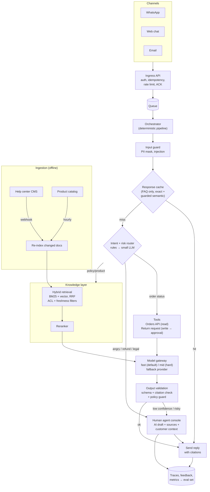

# Case 1 · Customer-Support Copilot

> **Prompt (interviewer):** "Design a customer-support copilot for an e-commerce company."
> **Design around:** RAG + fresh knowledge, citations, model routing, caching, escalation to humans, latency & cost constraints.

---

## 1. Requirements

### Clarifying questions (aur assumed answers)

| Sawal | Assumed answer |
|---|---|
| Copilot (human agents ki madad) ya autopilot (seedha customer)? | **Dono modes:** customer-facing bot for simple queries, aur human agents ke liye draft replies |
| Channels? | WhatsApp + web chat + email |
| Scale? | 20,000 conversations/day, ~4 messages each = **80k messages/day**, peak 5x (sale) |
| Kya actions? | Order status (read), return request create (write, approval), refund (human only) |
| Knowledge? | ~300 policy/help pages (weekly change), 5,000 products (daily change), orders (live) |
| Latency? | Web chat p95 < 3s (streaming), WhatsApp p95 < 5s, agent drafts < 4s |
| Quality bar? | Policy ka galat jawab = chargebacks + trust loss. **Citations zaroori** |
| Languages? | English, Urdu, Roman Urdu |
| Budget? | < $0.002 per message LLM cost |

### Success criteria
- Bot auto-resolution ≥ 50% (no human)
- Agent draft acceptance (as-is ya minor edits) ≥ 60%
- Wrong-policy rate < 1% (sampled human review)
- p95 latency within targets; availability 99.5%

### Back-of-envelope
```
80k msgs/day ÷ (14 busy h × 3600) ≈ 1.6 QPS avg  → peak ~8 QPS
Per message: ~2,500 input + 250 output tokens (with reasoning-low)
Fast model ($0.075/$0.30 per M):  80k × (2500×0.075 + 250×0.30)/1e6 ≈ $21/day ≈ $630/month
Budget:  $0.002 × 80k = $160/day  → fast model ~0.00026/msg, kaafi headroom
Mid-size model for 20% hard cases (~3x price):
   direct route: +0.2 × 630 × (3-1) ≈ +$250/month
   cascade (fast pehle try, phir mid): +0.2 × 630 × 3 ≈ +$380/month
   → total ~$900–1,000/month, budget ($4,800/month) ke andar
TPM at peak: 8 QPS × 60 × 2,750 ≈ 1.3M TPM  → provider tier check karna zaroori!
```

---

## 2. Baseline

**v0 (1 hafta):** Web chat only. System prompt + **top 30 policy pages stuffed** (~15k tokens, prompt-cached) + order-status tool. Ek fast model. Har jawab ke neeche "talk to human" button.

Measure: 200 real past tickets ka eval set (resolution correctness, citation correctness, tone). Ye baseline batayega ke kya masla **knowledge** hai (→ RAG), **reasoning** hai (→ routing), ya **actions** hain (→ tools).

---

## 3. Architecture



### Component decisions

| Component | Decision | Kyun |
|---|---|---|
| **Orchestration** | Deterministic pipeline, agent nahi | Flows predictable; latency + audit |
| **Router** | Rules (order no., keywords) → small LLM classifier for rest; risk tier output | Sasta; risky intents hamesha human |
| **Knowledge** | Policies: hybrid RAG (300 pages too many for stuffing at 80k msgs/day). Products: RAG on descriptions + **live tool for price/stock**. Orders: tool only | Freshness: live data kabhi RAG mein nahi |
| **Freshness** | CMS webhook → re-index that page; product hourly; `kb_version` in cache keys | Policy change minutes mein live |
| **Citations** | Chunks tagged `[S1]`; output validator checks every cited ID exists in context; no citation → no auto-send for policy answers | Trust + hallucination detection |
| **Model routing** | Fast model default; mid-size for multi-issue/complaint drafts; cascade on validator fail | Cost budget |
| **Caching** | Exact cache (normalized) for top FAQ; semantic only for allowlisted FAQ intents with entity guard; prompt caching for system prompt | 15–30% repeat traffic |
| **Escalation** | Rules (refund, legal, angry sentiment, 2 failed attempts) + validator fail → human console with AI draft | Copilot mode for hard cases |
| **Human console** | Draft + sources + order context + "why escalated" | Agent ka time 50% bachta hai |

### Copilot vs autopilot
| | Autopilot (bot → customer) | Copilot (draft → agent) |
|---|---|---|
| Risk | Higher (no human check) | Low (human approves) |
| Latency need | Strict | Relaxed (agent abhi reply likh raha hai) |
| Model | Fast | Can be stronger (mid/frontier) |
| Metric | Resolution rate, wrong-answer rate | Draft acceptance rate, handle-time reduction |

---

## 4. Bottlenecks

| Bottleneck | Symptom | Fix |
|---|---|---|
| Provider TPM at peak (1.3M TPM) | 429s on sale days | Higher tier, second provider, queue + backpressure, cache |
| Retrieval quality for Roman Urdu | Wrong chunks | Multilingual embeddings, query rewrite to English, BM25 on transliterations, eval by language |
| Reranker latency (+150ms) | p95 creep | Rerank only top-20, skip for cache-able FAQs |
| Agent console load during outages | Queue explodes | Canned answers + status banner + priority queue |

---

## 5. Failure modes

| Failure | Mitigation |
|---|---|
| Stale policy cited | Webhook re-index + `is_current` filter + kb_version in cache + TTL |
| Hallucinated policy / price | Citation validator, price must come from tool, "no source → no auto-send" |
| Prompt injection via customer message / email | Input guard, retrieved/user text as data, action tools behind approval |
| Wrong customer's order data | Order tool authorizes by **verified phone/email ↔ order** mapping, never by order no. alone |
| Provider outage | Breaker → fallback provider → canned + human queue |
| Duplicate webhook | Idempotency on message ID |
| Bot loop (bot ↔ auto-responder) | Per-conversation rate limit + loop detector |
| Escalation flood | Prioritize by sentiment/value; SLA timers |

---

## 6. Scaling

| Scale | Change |
|---|---|
| **10x** (800k msgs/day) | Horizontal workers; dedicated provider capacity/committed throughput; Redis cluster cache; vector DB managed; batch nightly analytics |
| **Multi-brand / multi-tenant** | Tenant namespaces in index + cache keys + per-tenant budgets & prompts |
| **New languages** | Per-language eval sets; routing by language to best model |
| **100x** | Consider self-hosting open model for hot path (cost), fine-tuned small model for classification/routing |

---

## 7. Trade-offs & rejected alternatives

| Rejected | Kyun |
|---|---|
| Fully agentic bot (LLM picks tools freely) | Latency, unpredictability, audit; flows are known |
| Stuffing all 300 pages | 150k tokens × 80k msgs = cost aur latency; lost-in-the-middle |
| Fine-tuning on past tickets | Old tickets mein purani policies; knowledge RAG se; behavior prompting se theek hai |
| Semantic cache on all intents | Entity/personalization errors (M9.5); sirf FAQ allowlist |
| Single provider | 99.5% SLO ke liye risky |
| Frontier model for everything | 10–40x cost; eval shows fast model enough for ~80% |

**Key trade-off statement:**
> "Hum ne quality ko citations + validators + human escalation se secure kiya, model size se nahi. Is se 80% traffic fast model par rehta hai aur cost budget ke 20% par hai. Jahan model fail hota hai, wahan human ke paas jaata hai, galat jawab nahi."

---

## 8. Evaluation & monitoring
- Offline: 500-case eval set (by intent × language), citation accuracy, faithfulness (Level 7), resolution correctness (judge + human sample)
- Online: thumbs, rephrase rate, escalation rate, draft acceptance rate, wrong-policy audits (weekly 100 random)
- Every escalated/failed conversation → triage → eval set (M9.8)
- Dashboards sliced by intent, language, channel, version

---

## 9. Interviewer probes (practice)

1. **"Policy aaj change hui. Kitni der mein bot naya jawab dega?"** → webhook → re-index that doc (~1 min), `is_current` flip, `kb_version` bump invalidates cache. Worst case nightly rebuild as backup.
2. **"Kaise pata ke citation sahi hai?"** → validator: cited IDs ∈ context; sampled groundedness judge; claims with numbers must match chunk text.
3. **"Bot ko refund dene do?"** → Nahi, auto. Eligibility rules in code, refund = Tier 3 → human approval; bot creates request + collects info.
4. **"Cost 3x ho gayi. Kya dekhoge?"** → per-feature/tenant ledger, tokens in/out trend, reasoning tokens, cache hit drop, routing % to mid model, retry amplification.
5. **"Sale day par 10x traffic."** → capacity math, pre-warm/raise limits, queue with backpressure, aggressive FAQ cache, degrade to canned + status for non-critical.
