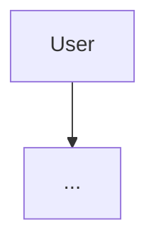

# [Product name]: AI System Design Document

| | |
|---|---|
| **Author** | |
| **Status** | Draft / In review / Approved |
| **Last updated** | |
| **Reviewers** | |
| **Version** | v0.1 |

---

## 0. Summary (5–7 lines)
- Kya bana rahe hain, kis ke liye:
- Core approach (1 line):
- Expected scale & cost:
- Biggest risk & mitigation:

## 1. Context & problem
- Abhi kya hota hai (current process), kya dard hai:
- Kyun AI? Kya AI ke bina ho sakta hai?

## 2. Requirements & success criteria
### 2.1 Functional
| # | Requirement | Priority (P0/P1/P2) |
|---|---|---|
| F1 | | |

### 2.2 Non-functional
| Dimension | Requirement |
|---|---|
| Latency | p95 < __ s |
| Availability | __ % |
| Languages | |
| Privacy | |
| Cost | < $__ / month |

### 2.3 Success criteria (numbers)
| Metric | Target | Kaise naapein |
|---|---|---|
| | | |

### 2.4 Out of scope (v1)
-

## 3. Expected traffic & constraints
### 3.1 Traffic
| | Now | 6 months | Peak |
|---|---|---|---|
| Requests/day | | | |
| Avg / peak QPS | | | |

### 3.2 Constraints
- Budget:
- Team / maintenance:
- Timeline:
- Platform / channel rules:
- Data residency / provider restrictions:

### 3.3 Back-of-envelope
```
tokens/request:
cost/request:
cost/month:
provider limits needed (RPM / TPM):
```

## 4. High-level architecture

### 4.1 Request walkthrough (step by step)
1.
### 4.2 Components & boundaries
| Component | Responsibility | Interface | Tech |
|---|---|---|---|

## 5. Model choice & routing
| Task | Model | Why | Fallback |
|---|---|---|---|
- Routing rules:
- Cascade / escalation criteria:
- Model eval results (baseline):

## 6. Context / knowledge (RAG) architecture
| Information | Source (model / prompt / RAG / tool / memory) | Freshness | Access control |
|---|---|---|---|
- Ingestion & update strategy:
- Retrieval (vector / keyword / hybrid / rerank), k, context budget:
- Provenance / citations:

## 7. Tools / agents
| Tool | Read/Write | Risk tier | Approval? |
|---|---|---|---|
- Workflow vs agent decision and why:

## 8. Caching strategy
| Cache | What | Key | TTL / invalidation | Expected hit rate |
|---|---|---|---|---|
- What is NOT cached and why:

## 9. Latency & cost budget
### 9.1 Latency budget (p95)
| Component | Budget |
|---|---|
| **Total** | |
### 9.2 Cost budget (monthly)
| Item | Estimate |
|---|---|
| LLM | |
| Other models (STT, embeddings) | |
| Channel / platform fees | |
| Hosting | |
| **Total** | |

## 10. Reliability & fallback strategy
| Failure | Detection | Response | User sees |
|---|---|---|---|
- Timeouts / retries / circuit breaker settings:
- Degradation ladder:
- SLOs:

## 11. Security & guardrails
| Boundary | Checks |
|---|---|
| Input | |
| Retrieval | |
| Output | |
| Actions | |
- Data protection (PII, retention, secrets):
- Threats considered (prompt injection, data leak, abuse):

## 12. Evaluation & monitoring
- Offline eval set (size, sources, metrics, pass thresholds):
- Online metrics & dashboards (slices):
- Alerts (threshold → runbook):
- Versioning (app / prompt / model / retrieval / KB):

## 13. User-feedback loop
- Explicit signals:
- Implicit signals:
- Failure → eval case process (owner, cadence):

## 14. Scaling strategy
| Scale | What breaks first | Change |
|---|---|---|
| 10x | | |
| 100x | | |

## 15. Trade-offs & rejected alternatives
| Decision | Chosen | Rejected alternative | Why rejected | Revisit when |
|---|---|---|---|---|

## 16. Risks & open questions
| Risk / question | Impact | Mitigation / owner |
|---|---|---|

## 17. Rollout plan
| Phase | Scope | Exit criteria |
|---|---|---|

## Appendix
- Prompt versions, eval results, cost calculations, references
